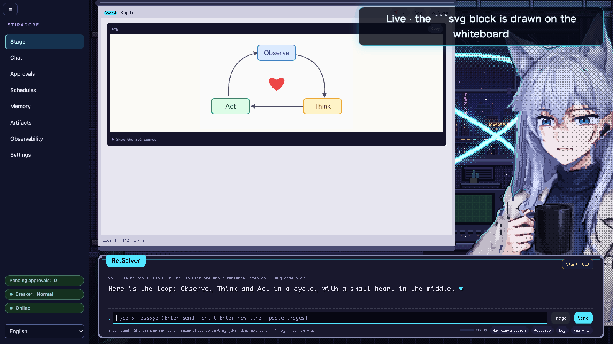
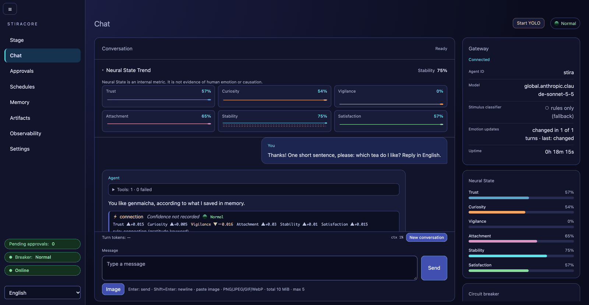
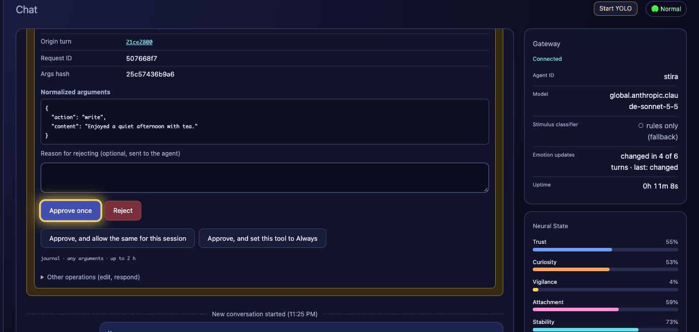
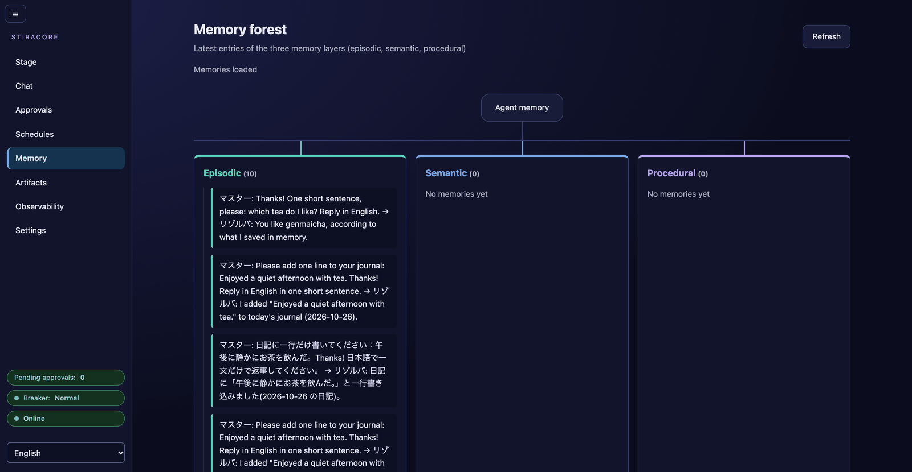
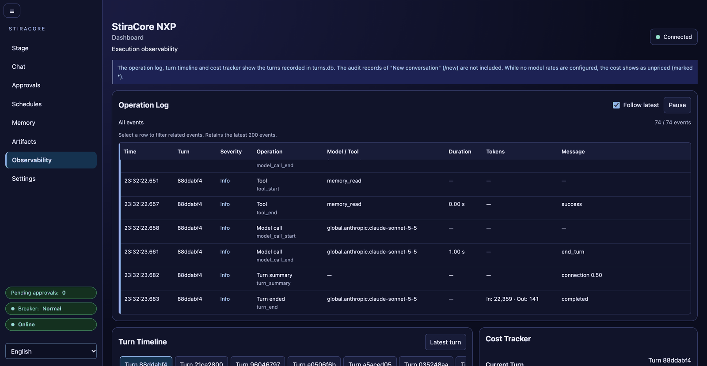

# StiraCore

**NXP/Stira-powered agent harness built on [Strands Agents SDK](https://github.com/strands-agents/sdk-python).**

English | [日本語](README_ja.md)

An original agent runtime that extends Strands with identity persistence, memory coherence detection, and circuit-breaker safety — the core of the NXP (Narrative Experience Protocol) framework.

"Emotion" here means a numeric state model used for agent state and safety control. It does not claim subjective feelings or consciousness.

> **Want this in your AI agent?** Hand it this repository's URL and say "install this" — it
> should read [docs/agent-setup.md](docs/agent-setup.md) and ask you before running each
> command. That is the house style here. (Draft wording.)

## Alpha status

StiraCore is an **alpha**. It runs, but parts of it are unfinished and some things do not work
yet. Known gaps on current `main`:

- **No stability promise.** This is `0.1.0.dev0`: the Python API, configuration keys, event and
  file formats and the data directory layout (`.local/stira/`) can change between commits,
  without migration code ([CHANGELOG](CHANGELOG.md)).
- **Local, single-user servers.** The web apps have no login. They listen on loopback and
  refuse other addresses unless `STIRA_ALLOW_REMOTE=1`; one data directory takes one server
  ([security model](#security-model), [operations §1](docs/operations.md#1-start-stop-status)).
- **Goal grants (autonomy) are experimental and off by default.** Amazon Bedrock only, no
  prompt caching inside an iteration, cost estimated from one supervised run only, and `run_checks`
  inside a grant only on macOS ([known limits](docs/autonomy.md#4-known-limits)).
- **Exec-class tools** (`shell`, `batch`, `cron`, `graph`, `swarm`, `think`, `use_agent`) are
  hidden by default and have no sandbox or background execution yet. Even with
  `STIRA_ENABLE_EXEC_TOOLS=1` they are registered only when the installed `strands-agents-tools`
  is a release the exec bridge was audited against — today **0.8.9** only. `pyproject.toml`
  therefore holds `strands-agents-tools` below 0.8.10 (`>=0.8.0,<0.8.10`), so a fresh install
  gets 0.8.9; this pin is a deliberate safety choice until a newer release is audited. An older
  or a manually upgraded release is refused for the exec class (the log says
  `Not registering shell: …`). Check with `python -m pip show strands-agents-tools`.
- **Emotion classification is basic.** With the default install the stimulus classifier is the
  rule-based one: its patterns are English and it detects almost nothing in Japanese. The
  Japanese Sokudan classifier needs the `jev` extra on Python 3.11
  ([stimulus classifiers](#stimulus-classifiers),
  [Japanese rule classifier, opt-in](docs/ja-rules-classifier.md)). There is no stimulus
  category for failure, frustration or pressure yet.
- **Long one-sided conversations saturate the Neural State**: stability runs towards 0 and the
  breaker sits at CRITICAL, which restricts write tools, for most turns. This is by design; the
  settings that shape it are in [neural-saturation](docs/neural-saturation.md).
- **Memory page**: a read-only list of the newest 20 entries per layer, text only — no search,
  no editing, no importance or retention shown. Procedural proposals are reviewed on that page;
  semantic staging only on the command line (`stira_ctl.sh staging`).
- **Other UI gaps**: scheduler jobs are created through the API only (`/schedules` lists, pauses,
  resumes and cancels them — [guide](docs/guide-scheduler-heartbeat.md)); one conversation at a
  time, with no session list, switch or search; the Stage polls (up to 5–10 s behind when idle),
  shows one approval at a time and does not show heartbeat ticks or scheduler runs
  ([Stage limits](docs/stage.md#limits-stage-2)).
- **`distiller_mode: "jev"` is a stub**: every episode fails. Use `rule` (the default, no model
  call) or `llm` ([memory maintenance](docs/memory-maintenance.md)).
- **Platforms.** Developed on macOS (Apple Silicon). The CI workflow runs the offline test suite
  on Ubuntu (Python 3.11 and 3.12) and macOS (3.11) — these are blocking — and a server start-up
  smoke plus the PowerShell control-script tests on Windows. **On Windows the full test suite also
  runs, but it is informational only (`continue-on-error`): several hundred tests still fail
  there** (path semantics, the scheduler, grants progress, timing; tracked in
  Issue #662 of this repository), so Windows is **not** a verified
  platform yet. Beyond CI, Linux was checked by hand only in a VM for the
  [EC2 reference setup](docs/deploy-ec2.md) (its AWS parts unverified), and Windows not at all
  (`stira_ctl.ps1`, the chat server; no `shell` or `cron` tool there). The YOLO window is
  offered on macOS only (the one platform whose clocks were measured), and the per-OS tool table
  is from source inspection, not an OS test run ([install §4, §6, §11](docs/install.md)).
- **Model providers.** Amazon Bedrock (the default) is the provider of every real-model run
  documented here. The other Strands providers (Ollama, llama.cpp, OpenAI, Anthropic, Gemini, …)
  are wired through `ModelSpec` and covered by offline contract tests with a fake model, but
  none has a documented real-model run yet; the opt-in live smoke checks yours
  ([providers](docs/providers.md#tests-and-live-smoke)).

Found something that does not work, or a gap that is not listed? Please open an Issue in this
repository.

## Screenshots

Captured on 2026-10-26 from a running build of `main` (fresh data directory, default tool rules,
Amazon Bedrock); the Stage art in them is CC BY 4.0 ([License](#license)).

| | |
|---|---|
| <br>**Stage** (opt-in, `STIRA_STAGE=1`): the agent's pixel-art view, idle, with the text window and the composer. | <br>**Whiteboard**: a reply's `svg` code block, rebuilt from an allow-list and drawn on the Stage board (a frame from a recording; the label at the top right is its caption). |
| <br>**Chat**: the six Neural State values with trends, and the per-turn change under a reply (the rule classifier read a thank-you as `connection`). | <br>**Approval card**: a write tool set to Ask waits for a person — the normalized arguments, their hash and the choices (the outline on *Approve once* was added for the recording). |
| <br>**Memory**: the newest entries of the episodic, semantic and procedural layers, read-only. | <br>**Observability**: the operation log — model calls, tool calls and turns with time, duration and tokens. |

## Status

🚧 **Early development (`0.1.0.dev0`)** — APIs and integration points may still change.
The CI matrix needs no cloud account: Ubuntu (Python 3.11 / 3.12), macOS and Windows
(Python 3.11). Built on:

- [Strands SDK](https://github.com/strands-agents/sdk-python) (agent/tool/model abstraction)
- Stira (collapse detection + circuit breaker), an earlier OpenClaw adapter and a decision
  router prototype — earlier work by the same author, not published

What is implemented today is listed under [Features](#features); planned work that does
**not** exist yet is listed under [Roadmap](#roadmap-not-implemented).

## Architecture

```
┌──────────────────────────────────────────────────────────────┐
│                     StiraCore Agent                       │
├──────────────────────────────────────────────────────────────┤
│  NXP Memory Layer                                            │
│  ├── Episodic / Semantic / Procedural (Markdown + SQLite)    │
│  ├── AmygdalaPass importance routing (discard/auto/staging)  │
│  └── Harvest distillation + staging review queue             │
├──────────────────────────────────────────────────────────────┤
│  Stira Engine                                                │
│  ├── NeuralState (6-dim state, lazy decay)                   │
│  ├── Circuit Breaker (NORMAL/WARNING/CRITICAL/COHERENCE)     │
│  ├── bcScore (behavioral coherence)                          │
│  └── HITL approvals bound to args + operation ledger         │
├──────────────────────────────────────────────────────────────┤
│  Context, protection & classification                        │
│  ├── ContextAssembler (SOUL + anchors + memory + state)      │
│  ├── IdentityGuard + SOUL read-only + protected_dirs         │
│  ├── SOUL compaction guard (turn-boundary re-injection)      │
│  └── Stimulus classifiers (rule / Sokudan)                   │
├──────────────────────────────────────────────────────────────┤
│  Strands Agent Core                                          │
│  ├── NXPAgent pre/post-turn lifecycle                        │
│  ├── Providers: ModelSpec / create_model (Bedrock default)   │
│  └── Tool registry (exec-class tools hidden by default)      │
├──────────────────────────────────────────────────────────────┤
│  Observability & UI                                          │
│  ├── Versioned turn events (SQLite, replay, SSE)             │
│  └── Flask apps: chat server + observation console           │
└──────────────────────────────────────────────────────────────┘
```

`NXPAgent` runs each turn as `pre_turn()` → tool filtering and context → Strands
call → stimulus classification and `post_turn()`. Callers do not invoke
`pre_turn()` / `post_turn()` themselves. See [docs/architecture.md](docs/architecture.md)
and the [diagrams](docs/diagrams/README.md).

## Key Concepts

| Concept | What it does |
|---|---|
| **Neural State** | 6 parameters (trust, curiosity, vigilance, attachment, stability, satisfaction) that act as regularization — preventing optimization from deleting personality. Baselines and decay rates live in `core/neural_state.py` |
| **Circuit Breaker** | Defaults: stability < 0.5 → WARNING (write tools withheld, identity injected); < 0.3 → CRITICAL (read-only by default; with `critical_action="halt"` the model still runs and every write/exec call needs a human approval). Hysteresis (WARNING exits above 0.6) and a cooldown (CRITICAL exits above 0.45 after at least 3 protected turns). All thresholds are configurable in `StiraConfig` |
| **bcScore** | Behavioral coherence score over a rolling stability window; a low score raises the separate COHERENCE level. Formula, window and initial-fill behaviour: [docs/coherence.md](docs/coherence.md) (`compute_bc_score`) |
| **3-Layer Memory** | Episodic (daily) → Semantic (distilled) → Procedural (skills). Markdown files are the source of truth; SQLite is a rebuildable search index |
| **Amygdala Pass** | Deterministic importance scoring on the write side, on the original turn text: < 0.4 discard, ≥ 0.7 staging for human review; 0.4–0.7 is staged too by default (`harvest_stage_auto`, until the review UI #193) and auto-promoted only when that is turned off |
| **Identity Anchors** | Layer 3+ constraints that optimization must never touch. "The things you must not delete for efficiency" |
| **SOUL read-only** | `SOUL.md` / `IPD.md` (and configured paths) cannot be modified by the agent at any breaker level |
| **Lazy Decay** | Time-based return to baseline that models forgetting. Keeps the system from over-fitting to recent events |

### Identity anchors — using your own

The built-in anchors are three neutral statements with no persona in them
(`stiracore.core.DEFAULT_IDENTITY_ANCHORS`). A deployment sets its own in
`agent-config.json` (chat server: `.local/stira/agent-config.json`, read at start-up):

```json
{"identity_anchors": ["First anchor", "Second anchor"]}
```

Only the keys you write are changed; the others keep their defaults. An
`identity_anchors` list that is already in your `agent-config.json` always wins over the
built-in one, so an existing configuration keeps its anchors; an install without the key
switches to the neutral list (one-time start-up warning `identity_anchors_default`; how to
keep the old list: [configuration.md](docs/configuration.md#identity-anchors-152)). The
anchors are prompt text: they declare, they do not enforce (the write floor does). A persona-specific example:
[`examples/personas/resolver/agent-config.json`](examples/personas/resolver/agent-config.json).
In code: `StiraConfig(identity_anchors=[...])`. The list must be non-empty; the start-up
banner shows `Identity anchors: default (3)`, `configured (N)` or `configured (3, same as built-in)`.

## Features

Everything below exists on `main`. "Opt-in" means it is off unless you enable or
wire it yourself; a minimal `NXPAgent(...)` does not start every component.

### Core engine and memory
- `StiraEngine` / `NeuralState` / `StiraConfig` work without any model or credentials
  ([quickstart](docs/quickstart.md)); decay is path-independent and resyncs on clock reversal.
- Circuit breaker with four levels (NORMAL / WARNING / CRITICAL / COHERENCE), hysteresis
  and CRITICAL cooldown ([ADR 0002](docs/adr/0002-breaker-enforcement.md),
  [state machine](docs/diagrams/statemachine-circuit-breaker.svg)).
- Identity Anchors (injected into the prompt by `ContextAssembler` and at WARNING) and
  `StiraEngine.check_layer_boundary()` for callers (`protected_layers`, default L3–L5).
- `MemoryStore`: three agent-scoped layers in Markdown with an SQLite index, plus
  Strands tools `memory_read` / `memory_write` / `memory_search` / `memory_list`
  (tools may write only the episodic layer) ([ADR 0003](docs/adr/0003-memory-design.md)).
- Harvest distillation (`python -m stiracore.control.distillation_cli`, or
  `stira_ctl.sh distill`): rule-based by default (no model call), optional LLM
  distiller on any provider; ≥ 0.7 entries (and, by default, 0.4–0.7) go to
  `semantic/staging/` and are approved or rejected with
  `python -m stiracore.control.staging_cli` / `stira_ctl.sh staging` or the
  `StagingReview` library API (rejections are remembered).
- `StatePersistence` (atomic JSON), `ContextAssembler` (token-budgeted system prompt),
  `NXPSessionManager`, local checkpoints with at-least-once replay
  ([checkpoints](docs/checkpoints.md)).
- SOUL compaction guard: re-injects the trusted system prompt and current state at turn
  boundaries ([soul-compaction](docs/soul-compaction.md)).
- Opt-in components: `HeartbeatGateway` (model-free decay/breaker tick with adaptive
  pacing; `stira_server` runs it in the background only with `hb_enabled` or
  `STIRA_HEARTBEAT=1`, off by default — [heartbeat-daemon](docs/heartbeat-daemon.md)),
  `SycophancyMonitor` middleware, isolated NXP subagents and official Strands
  delegation adapters ([harness-components](docs/harness-components.md)).

### Tools, approvals and scheduling
- Tool rules **Always / Ask / Never** per tool and the effective gate stack *rule → breaker →
  floor* (strictest wins), shown on `/settings#sec-tools`; the rules file is integrity-checked
  and locks (every tool Never) when it does not check out
  (#190,
  [ADR 0010](docs/adr/0010-tool-policy-gate-stack.md)).
- Durable, hash-chained approval store: a pending approval survives a restart and approving
  it resumes the paused tool batch; an unreadable or tampered store rejects everything
  (#240,
  [ADR 0006](docs/adr/0006-hitl-persistence.md)).
- `editor` is the SDK `file_editor` behind Stira's write sandbox
  (#245,
  [ADR 0004](docs/adr/0004-editor-file-editor-sandbox.md)); write-failure permission cards and
  `stira doctor` (#244,
  [diagnostics](docs/diagnostics.md)).
- Opt-in scheduler (`STIRA_SCHEDULER=1`, off by default): human-created jobs only, read-only
  tools, missed-run/overlap/budget/breaker rules, health notifications; on the chat server the
  model-free `health_check` action and `memory_harvest` (rule-only Harvest to staging; #251)
  (#239,
  [scheduler](docs/scheduler.md)).
- *Alpha, off by default:* goal grants (ADR 0011 stage C, #296) — a person-issued,
  time-, budget- and scope-limited grant for one goal, iterations in a dedicated session by a
  press or (opt-in twice) the heartbeat, a permit at every effect, completion verified by the
  person ([Autonomy](#autonomy-grant-scoped-goal-loop-alpha-off-by-default),
  [autonomy](docs/autonomy.md)).

### Context and cost (opt-in, off by default)
- Prompt cache, phase 1: static/volatile prompt split and Bedrock cache points for Claude
  models, cache usage and prefix fingerprints in turn events
  (#254, [prompt-cache](docs/prompt-cache.md)).
- Context management: large tool results offloaded to a durable, masked stash with a
  read-back tool, summarization at a utilization threshold
  (#258,
  [ADR 0005](docs/adr/0005-context-management.md)).

### Stimulus classifiers
- `RuleBasedClassifier`: dependency-free heuristics (its patterns are English; it detects
  almost nothing in Japanese — measured in an internal live probe).
- `SokudanClassifier` (Jev-compatible, Japanese, `GeneLab/sokudan-ja-310m`, `jev` extra,
  Python 3.11): runs on CPU without torch; measured p50 ≈ 22 ms on an Apple M1 Max.
  `get_classifier()` falls back to rules when Sokudan is not installed.

### Model providers
- `ModelSpec` / `create_model` cover the 12 Strands providers: Bedrock (default),
  Anthropic, OpenAI, OpenAI Responses, Ollama, llama.cpp, Gemini, LiteLLM, Mistral, Writer,
  Llama API, SageMaker ([providers](docs/providers.md)).
- Nothing in the harness requires AWS; the test suite runs offline with a fake Strands
  model, and a root `conftest.py` guard fails any test that would call AWS.
- Credentials by reference: configuration stores environment-variable **names** only.
- Capability table (`capabilities_for`) and provider-neutral usage normalisation; an
  unknown cost is reported as unknown, never `$0`.
- Secret-free connection test and next-turn model switching from the settings page.
- Opt-in live smoke: `pytest tests/test_provider_live.py -m live` with `STIRA_LIVE_MODEL`.

### Observability
- Versioned turn events (`turn_id`, tool calls, approvals, summary) stored in SQLite,
  replay API (`/api/turns`, `/api/turns/<id>/events`) and SSE `ui_event` streaming.
- Hash-chained `SQLiteEventStore` with a head anchor, `verify_chain()`, in-place migration of
  a legacy database, audit adapters and trajectory metrics (stage 1 of
  #171,
  [ADR 0009](docs/adr/0009-eventstore-chain.md)). Tamper evidence only: it grants nothing.
- Deterministic breaker experiments: `core/breaker_sim.py` and
  `scripts/breaker_reachability.py` ([breaker reachability](docs/breaker-reachability.md)).
- `scripts/live_probe.py`: drive the classifier + engine offline and record traces.
- Emotion-ablation evaluation harness, stage 1: `python -m stiracore.eval`
  (fixed scenarios, scripted runner without LLM calls, opt-in NXPAgent runner). Reports
  contain **measurements only** and are not evidence that the emotion module works
  ([pre-registration](docs/eval/emotion-ablation-prereg.md), #143).
- Optional Langfuse/OpenTelemetry exporter.

### Web UI
Two local Flask apps share one shell (`base.html`, design tokens, sidebar):
- **Chat server** `dashboard/stira_server.py` (`/chat`, `/approvals`, `/memory`,
  `/observability`, `/settings`): turn ribbon + Turn Inspector, in-chat tool cards with
  masked/paged input and output, approval cards plus an `/approvals` queue with decision
  history, read-only three-layer memory tree, image attachments.
- **Observation console** `dashboard/app.py` (`/`, `/observability`, `/settings`): state
  and manual stimulus inspection without a live agent.
- **Settings hub** (`/settings`): one draft for model/provider, classifier, breaker and
  tool permissions; presets (`safe` / `standard` / `developer`) with diff preview; change
  history (JSONL) with field-level rollback; provider settings and connection test.
- Japanese by default with an English switch (`?lang=en`); `scripts/i18n_extract.py --check`
  validates the catalogs. Accessibility gate: axe-core (jsdom) tests and WCAG token
  contrast checks. Details: [dashboard/README.md](dashboard/README.md).

### Integrations
- Slack (Socket Mode), Discord, and signed webhook ingress
  ([chat integrations](docs/chat-integrations.md)); OAuth (Authorization Code + PKCE)
  connector ([business integrations](docs/business-integrations.md)).
- Optional tools: Perplexity search ([docs/tools/perplexity.md](docs/tools/perplexity.md)),
  bounded web fetch, LSP-style Python analysis ([lsp-neural-viz](docs/lsp-neural-viz.md)),
  `page_check` — open the agent's own workspace page in a closed browser (no network), click,
  type and press keys on it, wait for an element or a text, check it with five fixed assertion
  forms (pass / fail decided by Stira), and get error counts, step results, the page text and
  screenshots, when
  Chrome / Chromium / Edge is installed; also one `http://localhost:<port>` server a person allowed on
  the settings page (no other host or port is reachable); Ask or Never only
  ([ADR 0015](docs/adr/0015-verification-browser-tool.md)); `run_checks` (opt-in,
  `gateway-config.json` `run_checks: {"phase": 1}`) — run the project's own tests and linters
  (`pytest`, `unittest`, `node --test`, `ruff`, `compileall`) on the agent's code in a
  throwaway copy with no network; inside a macOS sandbox profile, limits only on Linux;
  Ask by default ([ADR 0019](docs/adr/0019-verification-runner.md)).

### Developer experience
- `scripts/stira_ctl.sh` (macOS/Linux) and `scripts/stira_ctl.ps1` (Windows):
  `start | status | stop | restart | distill`, PID-checked stop, refuses an occupied port.
- Extras: `dashboard`, `dev`, `jev`, `harness`, `slack`, `discord`, `bedrock`, one per
  provider (`anthropic`, `openai`, `ollama`, `gemini`, `litellm`, `mistral`, `writer`,
  `llamaapi`, `sagemaker`) and `providers` (Anthropic + OpenAI + Ollama).
- Executable docs: `tests/test_docs_quickstart.py` runs the quickstart code;
  `tests/test_docs_sync.py` keeps the numbers in AGENTS.md (development repository only) equal to the code,
  and the environment-variable, config-field and data-directory tables of
  [configuration](docs/configuration.md) and the [ADR index](docs/README.md) equal to the code
  and the files.

## Autonomy: grant-scoped goal loop (ALPHA, off by default)

> **ALPHA — experimental.** It may change without notice. Do not leave it running unattended
> on anything you cannot lose. Overview, step-by-step trial and the full list of known
> limits: [docs/autonomy.md](docs/autonomy.md).

A person issues a **grant** for **one goal** in Settings → Goal grants: a time limit, a token
budget, an iteration limit, a tool scope and one working directory. Issuing it runs nothing.
Each iteration runs in its own session (`grant:<id>`, not the chat) when the person presses
**Run one iteration** — or, only if both the server and that grant allow it, when the
scheduler's model-free heartbeat check starts one (at most one per wake). The agent can
report progress, report a blocker or *claim* the goal is met; **only the person confirms
completion**. ADR 0011 stage C, #296 (W1–W6d on `main`).

**Switching it on** (`gateway-config.json`, read at start-up; the default in parentheses;
details in [configuration](docs/configuration.md#the-autonomy-section-adr-0011-stage-c-alpha)):

- `autonomy.stage_c` (`false`) — the grant control plane: issue, pause, resume, revoke,
  verify. Runs nothing by itself.
- `autonomy.stage_c_exec` (`false`, needs `stage_c`) — the iteration executor and the
  **Run one iteration** button.
- `autonomy.heartbeat_start` (`false`, needs `stage_c_exec`) — heartbeat-started iterations.
  They need **all** of: this switch, the scheduler (`STIRA_SCHEDULER=1`), the heartbeat
  daemon (`hb_enabled: true` or `STIRA_HEARTBEAT=1`, off by default — without it every
  wake is skipped), a restart, and a grant issued with its own flag ("Let the heartbeat
  start iterations", never changed later).
- `autonomy.tick_min_spacing_sec` (`300`, floor 30) — the shortest time from the issue, an
  iteration's end or a resume to a heartbeat-started iteration.
- `autonomy.run_checks_unattended` (`true`) — whether a grant may include `run_checks`;
  it also needs the `run_checks` tool on (`{"run_checks": {"phase": 1}}`, off by default)
  and a host whose OS sandbox is verified (macOS); otherwise such a grant is refused at
  issue.
- `autonomy.allow_browser_confirm` (`false`) — permit the weaker browser confirmation when
  no host channel is configured (`STIRA_YOLO_HOST_CONFIRM` unset / `browser`, or YOLO off
  with every `STIRA_YOLO_*` variable but `STIRA_YOLO_ALLOW=off` unset — else the server
  refuses to start);
  a configured host channel (`auto` / `dialog` / `command`) still takes precedence.
- `autonomy.claim_stale_sec` (`1800`) — when an unverified claim shows "still waiting for
  you" (display only). `autonomy.iteration_wall_sec` (`600`) bounds one iteration.

**On the Stage whiteboard** (`STIRA_STAGE=1`, Activity mode): the newest grant, read-only —
its state, iteration n / max, time and budget left, the last end in words, the last five
iterations, "waiting for your approval" / "awaiting your verification" cues, the evidence
measured at a claim and the heartbeat-start counts. No goal text, path or card content; the
controls stay in Settings. The goal text itself is stored only in `grants.json` (`0600`),
shown once to the issuer, and sent to the model in each iteration; logs, events and the
other views carry ids and codes only.

**Safety model:**

- Every grant is issued by a person with a **host confirmation** (the desktop dialog or
  `stira approvals decide`); without a host channel issue / resume / verify are refused
  unless the weaker browser layer was chosen explicitly. One live grant per server.
- **TTL** default 2 h, hard cap 6 h, never extended; **iterations** default 10, cap 20.
- **Budgets**: a total (≤ 5,000,000 tokens) and a per-iteration limit; each provider request
  is reserved against them before it is sent and never resets.
- **Kill switch** and Revoke need no confirmation and refuse every new permit at once (an
  effect already running finishes). The kill is then written as a latch that survives
  restarts until a person clears it with the server stopped — durable only once the latch
  is written (the kill answer says `latch: set`; `GET /api/authority/status` then lists
  `"kill"` in `latches` with `latch_store_healthy: true`); a restart before the write lands
  can come up not killed (documented limit). `/new`, the breaker leaving NORMAL, the TTL, a
  clock anomaly and every restart stop the grant.
- **Pre-emption**: a person's chat turn (any holder of the turn lock) makes a running
  iteration yield at its next boundary.
- **A permit at every effect**: each model call, tool call, approval wait and report is
  checked against the authority epoch and the grant right before the I/O.
- **No approval is answered automatically**: an Ask waits for a person's card; a
  heartbeat-started iteration never waits — it stops and blocks the goal.
- **Tools** are the grant's scope within `file_read`, `editor`, `run_checks`, the memory
  read tools and `current_time` (no shell, web, delegate or MCP); the editor stays in the
  working directory; `run_checks` only in a verified OS sandbox.
- **Completion is verified by the person**: a claim only waits for verification; the
  evidence shown is codes the harness measured, never model text.

Known limits include: Amazon Bedrock only; no prompt caching for iterations; per-iteration
cost not yet measured on a real model; same-user processes are out of scope; loop detection
is not guaranteed for cycles over more than 256 files — see
[docs/autonomy.md §4](docs/autonomy.md#4-known-limits).

## Security model

The web apps are **local development servers without authentication**. Defaults are
fail-closed:

- **Exec-class tools are hidden.** `shell`, `batch`, `cron`, `use_agent`, `swarm`, `graph`,
  `think` are not offered to the model unless `STIRA_ENABLE_EXEC_TOOLS=1` (or
  `get_tools(include_exec=True)`); no settings preset enables them. Enabled, every call
  still asks (Ask rule; they can never be Always). Background execution and a sandbox are
  not implemented yet (#167).
  With them enabled, human approvals done by local CLIs (procedural rules, staging) are only
  as strong as the OS user's permissions: run the agent as a different OS user from the
  approver, without write access to the data directory's `memory/` outside `episodic/`
  (EC2 guide #318; details in [tool-execution-paths](docs/tool-execution-paths.md)).
- **Breaker-based tool filtering.** WARNING withholds write-capable tools. CRITICAL is
  read-only by default; with `critical_action="halt"` (the chat server) the model still
  runs, reads continue, and every write-capable tool call needs a human approval (no
  approver attached → the call is rejected). Only isolated NXP subagents stop before the
  model call at HALT.
- **Tool rules and the gate stack** (#190): every call is decided by *rule → breaker →
  floor* and the strictest layer wins; an Ask approval answers the rule only and never
  lifts the breaker or the floor. Loosening a rule needs a confirmation and a NORMAL
  breaker and is audited first; a rules file that fails its integrity check locks every
  tool to Never until a person saves with the recovery word
  ([ADR 0010](docs/adr/0010-tool-policy-gate-stack.md), [operations](docs/operations.md)).
- **HITL approvals** are bound to agent, tool, a hash of the arguments, and an expiry;
  edits become new requests; no answer means reject. An operation ledger prevents
  duplicate side effects when a checkpoint is replayed ([hitl-approvals](docs/hitl-approvals.md)).
  Approvals are durable (#240): any doubt at start-up (an interrupted write, rows deleted
  from the end) cancels every unfinished approval instead of trusting it, a tampered store
  rejects everything, and a rule saved in between revokes every open approval
  ([ADR 0006](docs/adr/0006-hitl-persistence.md)). No environment variable approves anything.
- **Unattended work** stays bounded: the heartbeat never calls a model, and scheduled jobs
  (opt-in) are created only by a person, use read-only tools, stop at the first call that
  would need an approval, and do not start above NORMAL ([ADR 0008](docs/adr/0008-scheduler.md)).
  The opt-in goal grants (alpha) can let the scheduler's model-free check start a goal
  iteration only inside a grant a person issued for it ([autonomy](docs/autonomy.md)).
- **Identity files**: SOUL/IPD and configured `read_only_paths` are read-only at every
  level; `protected_dirs` (the chat server: `memory/procedural`) are enforced at the file-tool
  execution boundary ([soul-read-only](docs/soul-read-only.md)).
- **Write roots** (#243): `file_write`/`editor` may only write inside
  `AgentConfig.write_roots` (default: the agent's workspace). This deny-by-default comes
  from `AgentConfig`; library callers that pass no `write_policy` get the floor only
  ([tool-execution-paths](docs/tool-execution-paths.md#write-path-policy-243)).
- **Write diagnostics** (#244): a failed `file_write`/`editor` becomes a permission card
  (what, why, whose permission, steps for a person; one retry); `stira doctor` checks the
  write roots and changes nothing. Command-tool calls that name `xattr`/`chflags`/`sudo`/
  `tccutil`/`csrutil` in plain text are refused (not computed names — exec tools are off by
  default, #167) ([diagnostics](docs/diagnostics.md)).
- **Tool execution-path contract** for standard, MCP and delegated tools
  ([tool-execution-paths](docs/tool-execution-paths.md), [tool-audit](docs/tool-audit.md)).
- **Web hardening**: Host/Origin checks and CSRF token on every POST, CSP and security
  headers, idempotency keys on chat/approval/model endpoints, `mask_secrets` on tool
  previews, events, APIs and exports, and a bind guard that refuses non-loopback hosts
  unless `STIRA_ALLOW_REMOTE=1`. Every route is classified in the
  [admin/API permission matrix](docs/admin-api-permissions.md).
- **Credentials** are referenced by environment-variable name, never stored or echoed.

Known limits (measured, open): IdentityGuard and the file wrappers are **not an OS
sandbox**: the write-path check happens at one instant (the `editor` opens with
`O_NOFOLLOW` and `stira doctor` works through directory descriptors, but a concurrent
replacement by another process is out of scope, #167); a tool with no registry entry and
no write-shaped name is treated as read and still runs at CRITICAL; `protected_dirs` only
applies to `file_write` / `editor` (see [tool-execution-paths](docs/tool-execution-paths.md)).
The hash chains (approvals, scheduler log, EventStore) have no signature or external
anchor: someone who can write both a database and its head can rebuild a consistent chain
(#277). Since
#271 the data directory is on
the file tools' write floor except `workspace/`, the episodic layer and the context stash;
the stash can still be written by the agent and is read back unchecked
(#288). Restoring an older
backup brings older, possibly looser tool rules back without a lock
(#273; see
[operations §8](docs/operations.md#8-backup-and-restore)). `autonomy_boundary` in
`agent-config.json` is stored but not enforced
(#272), and one data directory
supports one server process: a second `stira_server` on the same directory refuses to
start ([operations §1](docs/operations.md#1-start-stop-status),
#285); other programs that open
the directory (e.g. `distill` while the server runs) are not excluded. The six stimulus categories
lack failure/frustration/pressure (#164),
and very long one-sided dialogs saturate the state (#165).

## Roadmap (not implemented)

These are planned or partly designed but **do not exist on `main`**:

- Approval-gated exec tools with background execution and sandbox — #167
- ACP client / ACP server / ACP delegation policy — #210, #211, #212
- Associative recall (read-side Amygdala Pass) — #170
- EventStore stages 2–3: chat server wiring of the audit adapters, moving the approval store and
  the scheduler log onto it, signing or an external anchor — #277
  (the remainder of #171)
- Agent-layer (model-calling) scheduled jobs, unattended jobs that wait for an approval, and
  the rest of the autonomous runtime — #105,
  #239. Of ADR 0011 (#296), the grant-scoped goal loop exists as an **alpha**
  ([Autonomy](#autonomy-grant-scoped-goal-loop-alpha-off-by-default); one supervised
  real-model smoke ran, W6e); still planned: YOLO two-binding inside an iteration (W7), taint
  and episodic origin for iterations (W8), a shared day budget pool, and bounded
  self-scheduling inside a human-defined envelope (stages A and B). Autonomy without a grant,
  always-on event-driven operation and self-expansion of permissions stay out of scope.
- Prompt cache follow-ups (settings-hub toggle, TTL strategy for heartbeat/cron, MCP tool
  order) — #254; context-management
  open points — #258; breaker tool
  hiding vs runtime refusal (needs a decision) — #259
- Time-limited Always rules and the other open points of ADR 0010 — #190, #270
- Diagnostics tab on the settings page — #267
- Session list / switch / search in the UI — #196
- Formal bcScore definition and COHERENCE behaviour while the window fills — #168
- Multilingual classifier and classifier switching beyond rule/Sokudan — #106
- Emotion-ablation evaluation beyond stage 1 (LLM runs, analysis) — #143

Tracking issues: UI #182,
providers/ACP #203.

## Project Structure

```
src/stiracore/
├── core/           # StiraEngine, NeuralState, AmygdalaPass, approvals, checkpoints, breaker_sim
├── agent/          # NXPAgent, ContextAssembler, classifiers, SOUL guard, sessions, subagents
├── providers/      # ModelSpec, create_model, credentials, capabilities, usage, connection test
├── middleware/     # IdentityGuard, Neural State, sycophancy, logging
├── tools/          # 3-layer memory, tool registry, identity-protected file tools, web/LSP tools
├── config/         # validated gateway/agent config and resolution
├── control/        # Harvest distillation, staging review, memory maintenance
├── heartbeat/      # model-free heartbeat gateway and pacing
├── scheduler/      # opt-in operator-defined jobs, chained event log
├── diagnostics/    # write-failure classification, `stira doctor`
├── observability/  # turn events, SSE, settings hub, shell, i18n, security, masking
├── integrations/   # Slack, Discord, webhook, OAuth
└── eval/           # emotion-ablation harness (python -m stiracore.eval)

dashboard/          # Flask apps (stira_server.py, app.py), templates, static assets
docs/               # design, setup, security and research documents
scripts/            # stira_ctl, live_probe, breaker_reachability, i18n_extract, …
tests/              # test suite (offline by default)
```

## Requirements

- Python 3.11+ (3.11 is the baseline on every OS; the `jev` extra needs 3.11)
- strands-agents >= 1.57.1
- strands-agents-tools >= 0.8.0, < 0.8.10 (held at the release the exec bridge was audited against)
- A model provider: Amazon Bedrock (default; AWS credentials) **or** any Strands
  provider without AWS — Ollama, llama.cpp, OpenAI, Anthropic, Gemini, … — see
  [Model providers](docs/providers.md)
- Flask for the web apps (`dashboard` or `dev` extra)

[pyproject.toml](pyproject.toml) is the dependency source of truth.

## Installation

See the [OS-specific installation guide](docs/install.md) for Linux, macOS, and
Windows setup, tool compatibility, and starting the observation console or chat
UI. [日本語のインストールガイド](docs/install_ja.md) is also available.
For AWS credentials and model access, follow [Authentication & Environment](docs/setup.md).

```bash
git clone https://github.com/Resolver-TNG/StiraCore.git
cd StiraCore
python3 -m venv .venv && source .venv/bin/activate   # Windows: py -3.11 -m venv .venv
python -m pip install -e '.[dashboard]'      # add jev, dev, a provider extra, … as needed
python scripts/smoke_server.py              # optional: server starts, /api/config = 200
```

### Quickstart without AWS

```bash
pip install -e '.[ollama]'          # or '.[openai]', '.[anthropic]'; llama.cpp needs no extra
```

```python
from stiracore import ModelSpec, NXPAgent

agent = NXPAgent(model=ModelSpec("ollama", "llama3.2:3b"))
print(agent("Hello!"))
```

See [docs/quickstart.md](docs/quickstart.md) for the engine without any model, a
Bedrock turn, context assembly and persistence, and [docs/providers.md](docs/providers.md)
for every provider, API-key environment variables, and live smoke tests.

## Quickstart: chat server in a clean venv

```bash
python3 -m venv /tmp/stira-venv && . /tmp/stira-venv/bin/activate
pip install -e ".[dashboard]"
```

Pick one model:

```bash
# 1) Fake model (no cloud, no key): the offline stand-in used by the tests
python tests/fake_bedrock_endpoint.py 5690 &
AWS_ENDPOINT_URL_BEDROCK_RUNTIME=http://127.0.0.1:5690 AWS_ACCESS_KEY_ID=dummy \
  AWS_SECRET_ACCESS_KEY=dummy AWS_DEFAULT_REGION=us-east-1 STIRA_PORT=5600 \
  python dashboard/stira_server.py          # every reply is "OK"
# 2) llama.cpp (llama-server on :8080)
STIRA_PROVIDER=llamacpp STIRA_MODEL=local STIRA_BASE_URL=http://127.0.0.1:8080 \
  STIRA_PORT=5600 python dashboard/stira_server.py
# 3) Amazon Bedrock (your AWS credentials and model access; see docs/setup.md)
STIRA_PORT=5600 python dashboard/stira_server.py
```

Open `http://127.0.0.1:5600/chat` and send a message. Data goes to `<repo>/.local/`
(git-ignored). If the model cannot be reached the chat shows a generic error after the turn.

### Stage (opt-in)

Stage is a pixel-art visual-novel view of what the agent is doing: the character, a text
window with the composer, approvals as a choice window, Neural State and the breaker. It
adds no permission. Start the server with `STIRA_STAGE=1` and open `/stage/`:

```bash
STIRA_STAGE=1 STIRA_PORT=5600 python dashboard/stira_server.py
```

Without `STIRA_STAGE=1` there is no `/stage` route. A reply's ```` ```svg ```` block is drawn on
the board as a picture rebuilt from an allow-list of shapes, colours and text (no script, link
or outside resource; on by default, off in Settings → "Board (Stage)", `ui.board_svg`).
Details: [docs/stage.md](docs/stage.md).

### Recently added

- **Safety layers** — identity guard, SOUL read-only, write/read floors, taint and
  containment ([containment.md](docs/containment.md), [taint.md](docs/taint.md)).
- **Approvals** — HITL cards bound to the argument hash ([hitl-approvals.md](docs/hitl-approvals.md)).
- **Allow again** — one press on an approval card allows the same tool on the same folder or host
  for the conversation (at most 2 hours, in memory, revocable from a badge), or saves the tool as
  Always through the settings hub once the call has run ([allow-again.md](docs/allow-again.md)).
- **YOLO window** — a time-boxed, audited auto-approve window. The `Start YOLO` button is
  shown by default and approves nothing until you press and confirm it;
  `STIRA_YOLO_ALLOW=off` hides it ([yolo-quickstart.md](docs/yolo-quickstart.md),
  [ADR 0012 addendum 2026-10-24](docs/adr/0012-yolo-mode.md)).
- **Progress reports** — interim reports during long turns ([model-progress.md](docs/model-progress.md)).
- **Artifacts** — files the agent produces, listed and previewed in the UI.
- **page_check / run_checks** — browser page checks and allow-listed check commands
  ([tool-definitions.md](docs/tool-definitions.md)).
- **Scheduler** — opt-in scheduled jobs ([scheduler.md](docs/scheduler.md)).
- **Goal grants (alpha, off by default)** — a person-issued, time-, budget- and scope-limited
  grant for one goal; iterations by a press or, opt-in, the heartbeat; the person verifies
  completion ([autonomy.md](docs/autonomy.md)).
- **Observability** — turns, tools, breaker and cost pages ([diagnostics.md](docs/diagnostics.md)).
- **Attack regression set** — `tests/attack/` ([attack-regression.md](docs/attack-regression.md)).

## Running on macOS / Windows / without AWS

**macOS (Apple Silicon)** — Python 3.11 venv, then:

```bash
.venv/bin/python -m pip install -e ".[jev,dashboard]"
scripts/stira_ctl.sh start      # status | stop | restart | distill
```

Port 5555 by default; set `STIRA_PORT` if it is taken (`start` refuses an occupied port).
Details: [install.md §10](docs/install.md#10-macos-apple-silicon-quick-setup-with-the-chat-server).

**Windows (PowerShell, not verified on Windows)** — `stira_ctl.ps1` runs
`.venv311\Scripts\python.exe`, so create that venv (`py -3.11 -m venv .venv311`), install
into it, then `.\scripts\stira_ctl.ps1 start|status|stop`. Execution policy and UTF-8 notes:
[install.md §4](docs/install.md#4-windows-powershell).

**Without AWS** — point the chat server at a local or hosted provider by environment
variable (or `.local/stira/gateway-config.json`):

```bash
STIRA_PROVIDER=llamacpp STIRA_MODEL=local STIRA_BASE_URL=http://127.0.0.1:8080 \
  python dashboard/stira_server.py
```

For hosted APIs set `STIRA_API_KEY_ENV` to the **name** of the variable holding the key.
Classifiers, memory and rule-based distillation never need AWS
([providers: running without AWS](docs/providers.md#running-without-aws-memory-distillation-tools)).

## Documentation index

| Topic | Document |
|---|---|
| All documents and ADRs | [docs/README.md](docs/README.md) |
| Install (Linux/macOS/Windows) | [install.md](docs/install.md) / [install_ja.md](docs/install_ja.md) |
| Optional: running on an always-on host such as EC2 (a reference setup: private access, instance role, systemd, backup) and the Mac / Windows / EC2 comparison | [deploy-ec2.md](docs/deploy-ec2.md) / [deploy-ec2_ja.md](docs/deploy-ec2_ja.md) |
| Configuration (environment variables, config files, data directory) | [configuration.md](docs/configuration.md) / [configuration_ja.md](docs/configuration_ja.md) |
| Operations (recovery, `stira doctor`, backup and restore) | [operations.md](docs/operations.md) / [operations_ja.md](docs/operations_ja.md) |
| AWS setup, IAM | [setup.md](docs/setup.md), [bedrock-iam-policy.md](docs/bedrock-iam-policy.md) |
| Quickstart (executed in tests) | [quickstart.md](docs/quickstart.md) |
| Model providers | [providers.md](docs/providers.md) / [providers_ja.md](docs/providers_ja.md) |
| Architecture and diagrams | [architecture.md](docs/architecture.md), [diagrams](docs/diagrams/README.md), [design-philosophy.md](docs/design-philosophy.md) |
| Design decisions | [ADR index](docs/README.md) (ADR 0001–0010) |
| Autonomy (alpha): goal grants, iterations, known limits | [autonomy.md](docs/autonomy.md) / [autonomy_ja.md](docs/autonomy_ja.md), [grants.md](docs/grants.md), [authority-service.md](docs/authority-service.md) |
| Opt-in features | [heartbeat-daemon.md](docs/heartbeat-daemon.md), [scheduler.md](docs/scheduler.md), [prompt-cache.md](docs/prompt-cache.md), [context-management.md](docs/context-management.md) |
| Memory maintenance (manual runs, OS timer examples, measured token cost; nothing runs by default) | [memory-maintenance.md](docs/memory-maintenance.md) / [memory-maintenance_ja.md](docs/memory-maintenance_ja.md), [examples/memory-maintenance/](examples/memory-maintenance/) |
| Safety | [hitl-approvals.md](docs/hitl-approvals.md), [diagnostics.md](docs/diagnostics.md), [tool-execution-paths.md](docs/tool-execution-paths.md), [tool-audit.md](docs/tool-audit.md), [soul-read-only.md](docs/soul-read-only.md), [soul-compaction.md](docs/soul-compaction.md), [admin-api-permissions.md](docs/admin-api-permissions.md) |
| Sessions, subagents, checkpoints | [harness-components.md](docs/harness-components.md), [checkpoints.md](docs/checkpoints.md) |
| Integrations | [chat-integrations.md](docs/chat-integrations.md), [business-integrations.md](docs/business-integrations.md) |
| Web UI | [dashboard/README.md](dashboard/README.md) |
| Evaluation and measurements | [eval prereg](docs/eval/emotion-ablation-prereg.md), [breaker-reachability.md](docs/breaker-reachability.md), [attack-regression.md](docs/attack-regression.md) |
| For agents running on the harness (development repository only; not in the public release) | AGENTS.md |

## Contributing, security and issue numbers

- Contributions: [CONTRIBUTING.md](CONTRIBUTING.md). Vulnerabilities: report them privately as
  described in [SECURITY.md](SECURITY.md), not in a public issue.
- Numbers such as `#123` in the documentation and code are from the maintainer's **private
  development tracker**, not issues of this repository. They are kept as stable IDs for the
  design history.

## License

- **Code:** Apache License 2.0 — see [LICENSE](LICENSE) and [NOTICE](NOTICE).
- **Stage assets** (the pixel-art character, background and props under
  `dashboard/stage/assets/`) and the screenshots in `docs/images/`:
  [CC BY 4.0](https://creativecommons.org/licenses/by/4.0/) —
  see [LICENSE-ASSETS](LICENSE-ASSETS). Credit Resolver-TNG when you reuse them.
- **three.js** (`dashboard/stage/vendor/`): MIT — see [NOTICE](NOTICE).
- The project's names and logos are not covered by these licences (Apache License 2.0,
  section 6).

---

Built by [Resolver-TNG](https://github.com/Resolver-TNG) — where NXP theory meets production runtime.
