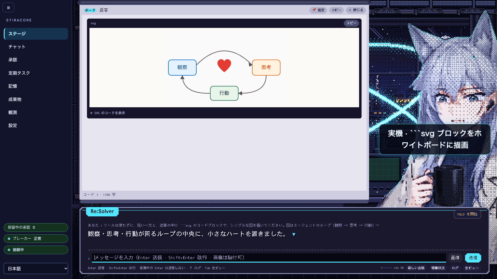
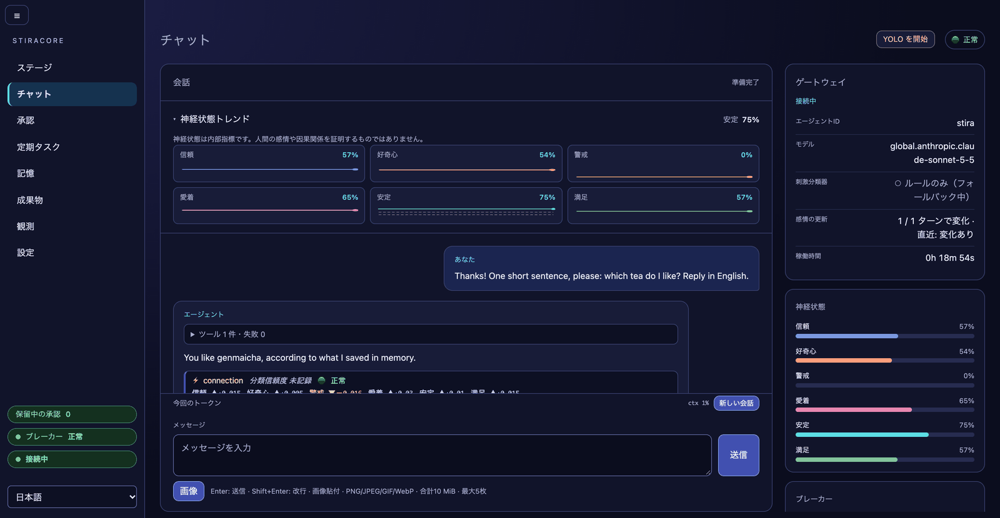
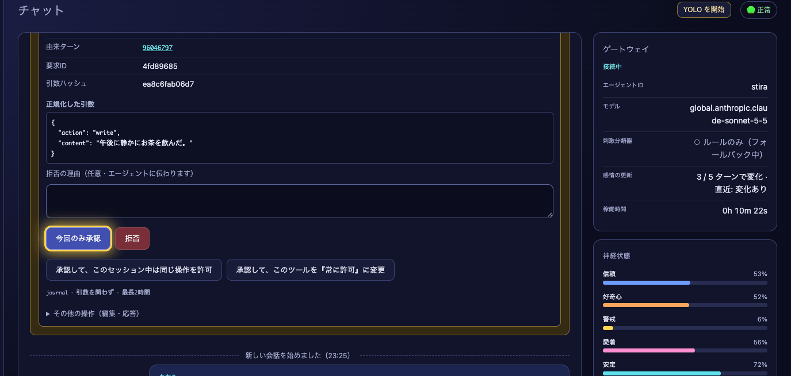
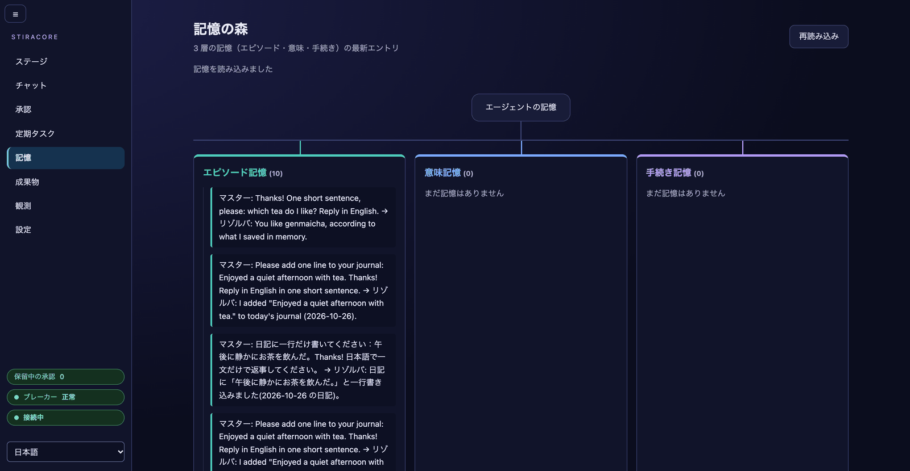
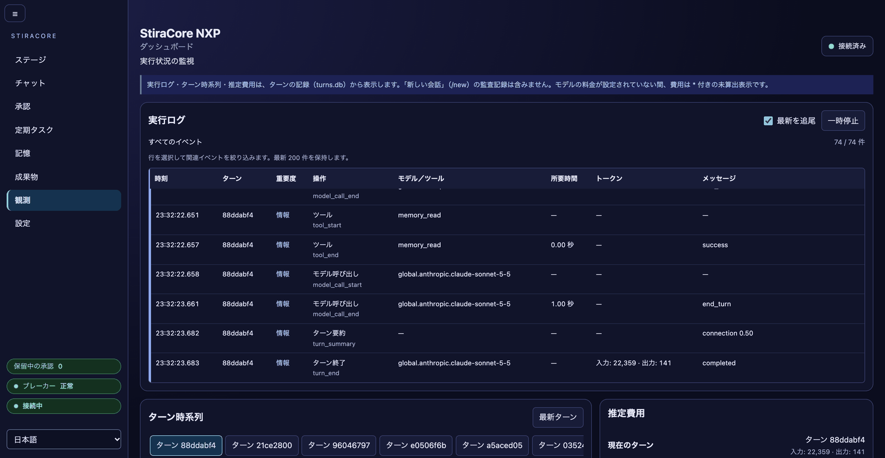

# StiraCore

**[Strands Agents SDK](https://github.com/strands-agents/sdk-python) を基盤に、NXP/Stira の人格・記憶・安全機構を組み込む AI エージェントハーネス。**

[English](README.md) | 日本語

StiraCore は、NXP（Narrative Experience Protocol）理論に基づくエージェント実行基盤です。Strands のモデル呼び出し・ツール実行に、人格の継続性、記憶の整合性、行動の一貫性の監視、サーキットブレーカーを加えます。

ここでいう「感情」は、エージェントの状態と安全制御に使う数値モデルです。主観的な感情や意識の存在を主張するものではありません。

> **これを自分の AI エージェントに入れたい?** このリポジトリの URL ごと渡して「これ入れて」と言え。
> エージェントは [docs/agent-setup_ja.md](docs/agent-setup_ja.md) を読み、コマンドを実行する前に毎回あなたに確認を取る。それがこのプロジェクトの流儀。(文面は仮)

## アルファ版の現状

StiraCore は**アルファ版**です。動きますが、未完成の部分があり、まだ動かないものもあります。現在の `main` で分かっている穴は次のとおりです。

- **安定性の約束はありません。** バージョンは `0.1.0.dev0` です。Python API、設定キー、イベントやファイルの形式、データディレクトリ（`.local/stira/`）の構成は、移行コードなしにコミット間で変わることがあります（[CHANGELOG](CHANGELOG.md)）。
- **ローカル・単一ユーザー向けのサーバーです。** Web アプリにログインはありません。ループバックで待ち受け、`STIRA_ALLOW_REMOTE=1` がない限りそれ以外のアドレスを拒否します。1 つのデータディレクトリで動かせるサーバーは 1 つです（[セキュリティモデル](#セキュリティモデル)、[運用 §1](docs/operations_ja.md#1-起動停止状態確認)）。
- **目標グラント（自律）は実験的で、既定オフです。** Amazon Bedrock のみ、反復内のプロンプトキャッシュなし、費用は見守り付きの 1 回の実行からの推定だけ、グラント内の `run_checks` は macOS のみです（[既知の制約](docs/autonomy_ja.md#4-既知の制約)）。
- **実行系ツール**（`shell`・`batch`・`cron`・`graph`・`swarm`・`think`・`use_agent`）は既定で非公開で、sandbox もバックグラウンド実行もまだありません。`STIRA_ENABLE_EXEC_TOOLS=1` にしても、導入済みの `strands-agents-tools` が実行系ブリッジの監査済みリリース（現在は **0.8.9** のみ）でなければ登録されません。そのため `pyproject.toml` は `strands-agents-tools` を 0.8.10 未満（`>=0.8.0,<0.8.10`）に固定しており、新規インストールでは 0.8.9 が入ります。この固定は、新しいリリースを監査するまでの意図的な安全上の選択です。古いリリースや手動で上げたリリースでは実行系は登録されず、ログに `Not registering shell: …` と出ます。確認は `python -m pip show strands-agents-tools` です。
- **感情の分類は簡素です。** 既定のインストールでは刺激分類器はルールベースで、そのパターンは英語のため、日本語ではほとんど何も検出しません。日本語の Sokudan 分類器には Python 3.11 と `jev` extra が必要です（[刺激分類器](#刺激分類器)、[日本語ルール分類器（任意）](docs/ja-rules-classifier_ja.md)）。失敗・苛立ち・圧力の刺激カテゴリはまだありません。
- **一方向の長い対話では Neural State が飽和します。** stability は 0 に近づき、ブレーカーはほとんどのターンで CRITICAL（書き込みツールが制限される）になります。これは設計どおりで、調整できる設定は [neural-saturation_ja](docs/neural-saturation_ja.md) にあります。
- **記憶ページ**は、各層の最新 20 件を本文だけ表示する読み取り専用の一覧です。検索・編集はできず、重要度や保持期間も表示されません。手続き記憶の提案はこのページでレビューできますが、意味記憶の staging はコマンドライン（`stira_ctl.sh staging`）だけです。
- **その他の UI の穴**：定期ジョブは API でしか作れません（`/schedules` では一覧・一時停止・再開・取消のみ。[ガイド](docs/guide-scheduler-heartbeat_ja.md)）。会話は一度に 1 つで、セッションの一覧・切替・検索はありません。Stage はポーリング（待機中は最大 5〜10 秒遅れ）で、承認は 1 件ずつ表示し、ハートビートの刻みやスケジューラの実行は表示しません（[Stage の制約](docs/stage.md#limits-stage-2)）。
- **`distiller_mode: "jev"` はスタブです**：すべてのエピソードが失敗します。`rule`（既定、モデル呼び出しなし）か `llm` を使ってください（[記憶の整理](docs/memory-maintenance_ja.md)）。
- **プラットフォーム。** 開発は macOS（Apple Silicon）です。CI のワークフローは、オフラインのテストスイートを Ubuntu（Python 3.11 と 3.12）と macOS（3.11）で実行し（この 2 つは必須）、サーバー起動スモークと PowerShell の制御スクリプトのテストを Windows でも実行します。**Windows では pytest のステップ（テストスイート全体とプロバイダ extras）も走りますが、参考扱い（`continue-on-error`）です。数百件のテストがまだ失敗します**（パスの意味論・スケジューラ・grants の進捗・時間依存。このリポジトリの Issue #662 で追跡）。そのため Windows はまだ検証済みのプラットフォームではありません。CI 以外では、Linux は [EC2 の参考構成](docs/deploy-ec2_ja.md) のための VM で手作業の確認をしただけ（AWS 部分は未確認）、Windows は未確認です（`stira_ctl.ps1`、チャットサーバー。Windows には `shell` と `cron` ツールがありません）。YOLO 窓は時計を実測した macOS でだけ提示され、OS 別のツール表はソースの調査によるもので OS 上のテストではありません（[インストール §4・§6・§11](docs/install_ja.md)）。
- **モデルプロバイダ。** ここに記録された実モデルでの実行は、すべて Amazon Bedrock（既定）です。ほかの Strands プロバイダ（Ollama、llama.cpp、OpenAI、Anthropic、Gemini など）は `ModelSpec` で接続され、偽モデルを使うオフラインの契約テストで確認されていますが、実モデルでの実行記録はまだありません。手元の環境はオプトインの live スモークで確認できます（[プロバイダ](docs/providers_ja.md#テストと-live-スモーク)）。

動かないもの、ここに載っていない穴を見つけたら、このリポジトリの Issue で知らせてください。

## スクリーンショット

2026-10-26 に `main` のビルドを動かして撮影しました（新しいデータディレクトリ、既定のツールルール、Amazon Bedrock）。写っている Stage のアートは CC BY 4.0 です（[ライセンス](#ライセンス)）。

| | |
|---|---|
| <br>**Stage**（任意、`STIRA_STAGE=1`）：エージェントのドット絵ビュー。待機中の画面と、テキストウィンドウ・入力欄。 | <br>**ホワイトボード**：返答の `svg` コードブロックを許可リストから組み立て直し、Stage のボードに描いたもの（録画の 1 コマ。右の文字は録画の字幕）。 |
| <br>**チャット**：6 つの神経状態の値と推移、返答の下にターンごとの変化（ルール分類器がお礼を `connection` と読んだ例）。 | <br>**承認カード**：「毎回確認」の書き込みツールが人の判断を待つ。正規化した引数、そのハッシュ、選択肢（「今回のみ承認」の縁取りは録画用に付けたもの）。 |
| <br>**記憶**：エピソード・意味・手続きの各層の最新エントリ（読み取り専用）。 | <br>**観測**：実行ログ。モデル呼び出し・ツール呼び出し・ターンを、時刻・所要時間・トークンとともに記録。 |

## アーキテクチャ

```text
StiraCore Agent
├── NXP 記憶層
│   ├── Episodic：日次ログ・出来事
│   ├── Semantic：蒸留された知識（staging はレビュー待ち）
│   ├── Procedural：スキル・ワークフロー
│   └── AmygdalaPass / Harvest：重要度の振り分けと蒸留
├── Stira Engine
│   ├── NeuralState：6次元の状態パラメータ
│   ├── bcScore：行動的一貫性の指標
│   ├── Circuit Breaker：NORMAL / WARNING / CRITICAL / COHERENCE
│   ├── HITL 承認：引数ハッシュへの束縛と操作台帳
│   └── Lazy Decay：時間経過による基準値への減衰
├── コンテキスト・保護・分類
│   ├── ContextAssembler：SOUL・記憶・状態の組み立て
│   ├── IdentityGuard / SOUL 読み取り専用 / protected_dirs
│   ├── SoulCompactionGuard：圧縮後の人格情報の再注入
│   ├── 刺激分類器：ルールベース / Sokudan（Jev 互換）
│   └── HeartbeatGateway：モデルを呼ばない定期状態確認（任意接続）
├── Strands Agent Core
│   ├── プロバイダ抽象：ModelSpec / create_model（既定は Bedrock）
│   ├── ツール登録：実行系ツールは既定で非公開
│   ├── NXPAgent の pre/post-turn ライフサイクル
│   └── セッション・子エージェント連携
└── 観測・UI
    ├── 版つきターンイベント（SQLite・再生・SSE）
    └── Flask アプリ：チャットサーバー（`stira_server`）／観測コンソール
```

通常の対話は `NXPAgent` が `pre_turn()` → ツール制限・コンテキスト準備 → Strands 実行 → 感情刺激の分類・`post_turn()` の順に処理します。SOUL 圧縮保護もターン境界で実行します。呼び出し側が `pre_turn()` / `post_turn()` を重ねて呼ぶ必要はありません。

## 主要概念・機能

| 機能 | 役割 |
|---|---|
| **NeuralState** | `trust`、`curiosity`、`vigilance`、`attachment`、`stability`、`satisfaction` の6次元で状態を表現。人格の継続性を支える正則化項として扱います。 |
| **bcScore** | ローリングウィンドウ内の `stability` の変動から行動的一貫性を評価し、低下すると COHERENCE レベルになります。式・窓・初期充填時の挙動は [docs/coherence_ja.md](docs/coherence_ja.md)（`compute_bc_score`）。 |
| **サーキットブレーカー** | 安定性低下に応じて書き込み制限・人格情報の注入・通知要求を生成します。既定では `stability < 0.5` で WARNING、`< 0.3` で CRITICAL。WARNING の解除は `> 0.6`（ヒステリシス）、CRITICAL の解除は `> 0.45` かつ 3 ターン以上の保護期間（クールダウン）。閾値、回復条件、HALT 方針は `StiraConfig` で設定可能です。 |
| **3層記憶** | エピソード・意味・手続き記憶を分離。Markdown を正本とし、SQLite を再構築可能な検索インデックスとして使います。 |
| **Amygdala** | 記憶の重要度を要約前のターン原文で決定的にスコアリングし、`< 0.4` 蒸留しない・`≥ 0.7` レビュー待ち（staging）に振り分けます。`0.4〜0.7` も既定ではレビュー待ちに入り（`harvest_stage_auto`、レビュー UI #193 まで）、無効にしたときだけ意味記憶へ自動昇格します。書き込み側の選別のみ実装済みで、読み出し側の連想想起は未実装です（#170）。 |
| **IdentityGuard / Identity Anchors** | SOUL 等の保護パスと Layer 3 以上の境界を検査し、人格の核に対する変更を制限します。 |
| **刺激分類（Jev 互換）** | 対話モデルとは別の分類器から刺激カテゴリ・強度・短い説明を得て NeuralState に反映。ルールベース分類器と、任意依存の日本語 Sokudan 分類器を備えます。 |
| **SOUL 圧縮保護** | 信頼できる system prompt を保存し、履歴縮小やプロンプト欠落を検知すると、人格情報と最新状態を再注入します。会話要約から人格を推測し直しません。 |
| **Lazy Decay / ハートビート** | 時間経過で状態を基準値へ戻します（刻み方に依存せず、時計の逆行時は減衰せず再同期）。`HeartbeatGateway` は LLM を呼ばずに decay・スナップショット・breaker 確認を行います。stira_server への常駐接続は opt-in（`hb_enabled` または `STIRA_HEARTBEAT=1`、既定 OFF。[heartbeat-daemon](docs/heartbeat-daemon.md)）。cron 形式の定期ジョブはオプトインのスケジューラ（`STIRA_SCHEDULER=1`、チャットサーバーでは `health_check` のみ。[scheduler](docs/scheduler.md)）で、モデルを呼ぶジョブは未実装です（#105）。 |

### 安全機構の境界

- WARNING では確認用の対話ゲートがないため、確認要求の対象となる書き込みツールを無効化します。CRITICAL は既定で読み取り専用です。`critical_action="halt"`（チャットサーバーの設定）でもモデルは呼ばれ、読み取りは続き、書き込み可能ツールの呼び出しごとに人間の承認を求めます（承認者が接続されていなければ拒否）。HALT でモデル呼び出しの前に止まるのは隔離された NXP サブエージェントだけです。
- ツール制限は名前と登録された分類に依存します。書き込み可能な独自ツール・別名も適切に設定してください。IdentityGuard を含め、OS のサンドボックスの代替ではありません。
- SOUL 圧縮保護は**ターン境界の保護**です。ターン内部の再試行ごとの復元や、同じ長さの書き換えをすべて検知する保証はありません。詳細は [SOUL 圧縮保護](docs/soul-compaction.md) を参照してください。
- 3層記憶、SOUL 読み込み、永続化、ハートビートは必要なコンポーネントを明示的に接続して使います。最小の `NXPAgent` 生成だけで全機能が起動するわけではありません。

### Identity Anchors を自分で設定する

組込みのアンカーは、ペルソナを含まない中立な 3 つの文です（`stiracore.core.DEFAULT_IDENTITY_ANCHORS`）。
自分のアンカーは `agent-config.json`（チャットサーバーでは `.local/stira/agent-config.json`、起動時に読む）に書きます。

```json
{"identity_anchors": ["一つ目のアンカー", "二つ目のアンカー"]}
```

書いたキーだけが変わり、他は既定値のままです。すでに `agent-config.json` にある `identity_anchors` は
常に組込みより優先されるので、既存の設定のアンカーはそのまま使われます。キーの無い環境は中立のリストに切り替わります
（起動時に `identity_anchors_default` の警告を 1 回。以前のリストを残す方法は [configuration_ja.md](docs/configuration_ja.md#identity-anchors152)）。
アンカーはプロンプト上の宣言で、強制力はありません（強制するのは書込みの床）。ペルソナ固有の例:
[`examples/personas/resolver/agent-config.json`](examples/personas/resolver/agent-config.json)。
コードからは `StiraConfig(identity_anchors=[...])`。空のリストは不可。起動時の表示は
`Identity anchors: default (3)`、`configured (N)`、`configured (3, same as built-in)` のいずれかです。

## 機能一覧

以下は `main` に実装済みのものです。「任意」は明示的に有効化・接続した場合のみ動作します。

### コアエンジンと記憶
- `StiraEngine` / `NeuralState` / `StiraConfig` はモデルや認証情報なしで動作します（[クイックスタート](docs/quickstart.md)）。
- 4 レベル（NORMAL / WARNING / CRITICAL / COHERENCE）のブレーカー、ヒステリシス、CRITICAL のクールダウン（[ADR 0002](docs/adr/0002-breaker-enforcement.md)、[状態遷移図](docs/diagrams/statemachine-circuit-breaker.svg)）。
- Identity Anchors（`ContextAssembler` と WARNING 時にプロンプトへ注入）と、呼び出し側が使う `StiraEngine.check_layer_boundary()`（`protected_layers`、既定 L3〜L5）。
- `MemoryStore`：エージェント単位の3層記憶（Markdown + SQLite インデックス）と Strands ツール `memory_read` / `memory_write` / `memory_search` / `memory_list`（ツールから書けるのはエピソード層のみ）（[ADR 0003](docs/adr/0003-memory-design.md)）。
- Harvest 蒸留（`python -m stiracore.control.distillation_cli` または `stira_ctl.sh distill`）：既定はルールベース（モデル呼び出しなし）、任意のプロバイダで LLM 蒸留も可能。`≥ 0.7`（既定では `0.4〜0.7` も）は `semantic/staging/` に入り、`python -m stiracore.control.staging_cli` / `stira_ctl.sh staging` または `StagingReview`（ライブラリ API）で承認・却下します（却下は記録され再提案されません）。
- `StatePersistence`（アトミックな JSON 保存）、`ContextAssembler`（トークン予算つき system prompt）、`NXPSessionManager`、at-least-once 再実行のローカルチェックポイント（[checkpoints](docs/checkpoints.md)）。
- 任意コンポーネント：`HeartbeatGateway`（モデルを呼ばない decay / ブレーカー tick、適応的な実行間隔。`stira_server` でのバックグラウンド実行は `hb_enabled` または `STIRA_HEARTBEAT=1` のときだけで既定 OFF — [heartbeat-daemon](docs/heartbeat-daemon.md)）、`SycophancyMonitor` ミドルウェア、隔離された NXP 子エージェントと公式 Strands 委譲アダプター（[harness-components](docs/harness-components.md)）。

### ツール・承認・定期実行
- ツールごとのルール **Always / Ask / Never** と、実効ゲート・スタック *ルール → ブレーカー → 床*（最も厳しいものが勝つ）を `/settings#sec-tools` に表示。ルールのファイルは完全性検査され、検査に通らなければロック（全ツール Never）されます（#190、[ADR 0010](docs/adr/0010-tool-policy-gate-stack.md)）。
- 永続・ハッシュ連鎖の承認ストア：保留中の承認は再起動後も残り、承認すると止まっていたツールのバッチを再開します。読めない・改竄されたストアはすべて拒否します（#240、[ADR 0006](docs/adr/0006-hitl-persistence.md)）。
- `editor` は Stira の書込みサンドボックスの背後にある SDK の `file_editor`（#245、[ADR 0004](docs/adr/0004-editor-file-editor-sandbox.md)）。書込み失敗の権限カードと `stira doctor`（#244、[diagnostics](docs/diagnostics.md)）。
- オプトインのスケジューラ（`STIRA_SCHEDULER=1`、既定 OFF）：人間が作ったジョブのみ、読取り専用ツールのみ、取りこぼし・重複・予算・ブレーカーの規則、ヘルス通知。チャットサーバーではモデルを呼ばない `health_check` アクションと `memory_harvest`（rule のみの Harvest で結果を staging へ、#251）（#239、[scheduler](docs/scheduler.md)）。
- *アルファ版・既定オフ:* 目標グラント（ADR 0011 ステージ C、#296）— 人が発行する、時間・予算・範囲を決めた 1 つの目標のグラント。反復は専用セッションで、押下か（二重のオプトインで）ハートビートで動き、効果ごとに許可を取り、完了は人が確認します（[自律](#自律-grant-付きゴールループアルファ版既定オフ)、[autonomy_ja](docs/autonomy_ja.md)）。

### コンテキストとコスト（オプトイン、既定 OFF）
- プロンプトキャッシュ第1段階：静的／揮発プロンプトの分離と Claude モデル向けの Bedrock キャッシュポイント、ターンイベントへのキャッシュ使用量とプレフィックス指紋の記録（#254、[prompt-cache](docs/prompt-cache.md)）。
- コンテキスト管理：大きなツール結果をマスク済みの永続退避領域へ移し読み戻しツールで参照、利用率の閾値で要約（#258、[ADR 0005](docs/adr/0005-context-management.md)）。

### 刺激分類器
- `RuleBasedClassifier`：依存なしのヒューリスティック。パターンは英語のため、日本語ではほぼ検出しません（内部の実機プローブで測定）。
- `SokudanClassifier`（Jev 互換、日本語、`GeneLab/sokudan-ja-310m`、`jev` extra、Python 3.11）：torch 不要で CPU 動作。Apple M1 Max の実測で p50 約 22 ms。未インストール時、`get_classifier()` はルールベースにフォールバックします。

### モデルプロバイダ
- `ModelSpec` / `create_model` で Strands の 12 プロバイダに対応：Bedrock（既定）、Anthropic、OpenAI、OpenAI Responses、Ollama、llama.cpp、Gemini、LiteLLM、Mistral、Writer、Llama API、SageMaker（[モデルプロバイダ](docs/providers_ja.md)）。
- ハーネスのどの部分も AWS を必須としません。テストは偽の Strands モデルでオフライン実行され、ルートの `conftest.py` が AWS へ送信しようとするテストを失敗させます。
- 認証情報は参照のみ：設定に保存するのは環境変数の**名前**だけです。
- 能力表（`capabilities_for`）とプロバイダ非依存の usage 正規化。不明なコストは `$0` ではなく「不明」として扱います。
- 秘密を含まない接続テストと、設定画面からの次ターン以降のモデル切替。
- 任意の live スモーク：`STIRA_LIVE_MODEL` を指定して `pytest tests/test_provider_live.py -m live`。

### 観測
- 版つきターンイベント（`turn_id`・ツール呼び出し・承認・要約）の SQLite 保存、再生 API（`/api/turns`、`/api/turns/<id>/events`）、SSE の `ui_event` 配信。
- head つきハッシュ連鎖の `SQLiteEventStore`、`verify_chain()`、旧データベースのその場移行、監査アダプター、軌跡指標（#171 の第1段階、[ADR 0009](docs/adr/0009-eventstore-chain.md)）。改竄の証拠のためだけのもので、権限は何も与えません。
- 決定的なブレーカー実験：`core/breaker_sim.py` と `scripts/breaker_reachability.py`（[到達性レポート](docs/breaker-reachability.md)）。
- `scripts/live_probe.py`：分類器とエンジンをオフラインで駆動し、トレースを記録します。
- 感情アブレーション評価ハーネス第1段階：`python -m stiracore.eval`（固定シナリオ、LLM を呼ばない scripted ランナー、任意の NXPAgent ランナー）。レポートは**測定値のみ**で、感情モジュールの効果の証明ではありません（[事前登録](docs/eval/emotion-ablation-prereg.md)、#143）。
- 任意の Langfuse / OpenTelemetry エクスポーター。

### Web UI
2 つのローカル Flask アプリが共通の shell（`base.html`・デザイントークン・サイドバー）を使います。
- **チャットサーバー** `dashboard/stira_server.py`（`/chat`・`/approvals`・`/memory`・`/observability`・`/settings`）：ターン・リボンと Turn Inspector、入出力をマスク・ページングするチャット内ツールカード、承認カードと決定履歴つきの `/approvals` キュー、3層記憶の読み取り専用ツリー、画像添付。
- **観測コンソール** `dashboard/app.py`（`/`・`/observability`・`/settings`）：ライブエージェントなしで状態と手動刺激を確認。
- **設定ハブ**（`/settings`）：モデル・プロバイダ、分類器、ブレーカー、ツール権限を 1 つの下書きで編集。プリセット（`safe` / `standard` / `developer`）と差分プレビュー、項目単位で戻せる変更履歴（JSONL）、プロバイダ設定と接続テスト。
- 既定は日本語、English に切替可能（`?lang=en`）。`scripts/i18n_extract.py --check` でカタログを検証。a11y ゲートとして axe-core（jsdom）テストと WCAG コントラスト検査があります。詳細は [dashboard/README.md](dashboard/README.md)。

### 外部連携
- Slack（Socket Mode）・Discord・署名つき webhook（[チャット連携](docs/chat-integrations.md)）、OAuth（Authorization Code + PKCE）コネクター（[業務連携](docs/business-integrations.md)）。
- 任意ツール：Perplexity 検索（[docs/tools/perplexity.md](docs/tools/perplexity.md)）、上限つき Web 取得、Python 解析（[lsp-neural-viz](docs/lsp-neural-viz.md)）、`page_check`（エージェントが作ったワークスペース内のページを、通信を閉じたブラウザで開き、クリック・文字入力・キー入力をして、要素や文字列が出るまで待ち、5 種類の決まったアサーション（合否は Stira が判定）で確かめ、エラー件数・各操作の結果・ページのテキスト・スクリーンショットを得る。Chrome / Chromium / Edge があるときだけ。人が設定画面で許可した `http://localhost:<ポート>` のサーバー 1 つも開ける（他のホストやポートには届かない）。規則は「確認」か「しない」のみ。[ADR 0015](docs/adr/0015-verification-browser-tool.md)）。
- 任意ツール（オプトイン）：`run_checks`（`gateway-config.json` の `run_checks: {"phase": 1}` でオン）。エージェントが書いたコードに、プロジェクト自身のテストとリンター（`pytest`・`unittest`・`node --test`・`ruff`・`compileall`）を、通信なしの使い捨てコピーで実行する。macOS ではサンドボックス設定の中、Linux では制限のみ。既定は「確認」（[ADR 0019](docs/adr/0019-verification-runner.md)）。

### 開発者体験
- `scripts/stira_ctl.sh`（macOS/Linux）と `scripts/stira_ctl.ps1`（Windows）：`start | status | stop | restart | distill`。停止は PID とコマンドラインを確認、使用中のポートでは起動を拒否。
- extras：`dashboard`、`dev`、`jev`、`harness`、`slack`、`discord`、`bedrock`、プロバイダごと（`anthropic`、`openai`、`ollama`、`gemini`、`litellm`、`mistral`、`writer`、`llamaapi`、`sagemaker`）と `providers`（Anthropic + OpenAI + Ollama）。
- 実行されるドキュメント：`tests/test_docs_quickstart.py` がクイックスタートのコードを実行し、`tests/test_docs_sync.py` が AGENTS.md（開発リポジトリのみ）の数値と実装の一致、[設定リファレンス](docs/configuration_ja.md) の環境変数・設定項目・データディレクトリの表とコードの一致、[ADR 索引](docs/README.md) とファイルの一致を検査します。

## 自律: grant 付きゴールループ（アルファ版、既定オフ）

> **アルファ版 — 実験的です。** 予告なく変わることがあります。失って困るものの上で、見張りなしに
> 動かしたままにしないでください。概要・試し方の手順・既知の制約の一覧:
> [docs/autonomy_ja.md](docs/autonomy_ja.md)。

人が設定 → 目標グラントで、**1 つの目標**に対する**グラント**を発行します: 時間の上限、トークン予算、
反復の上限、使ってよいツールの範囲、作業ディレクトリ 1 つ。発行しただけでは何も動きません。各反復は
チャットとは別の専用セッション（`grant:<id>`）で、人が **1 反復だけ実行** を押したとき — または、
サーバーとそのグラントの両方が許しているときだけ、スケジューラーのモデルを使わないハートビートの確認が
始めたとき（起床 1 回につき最大 1 反復）— に動きます。エージェントは進捗の報告、行き詰まりの報告、目標を
達成したという*申告*ができますが、**完了を確定するのは人だけ**です。ADR 0011 のステージ C、#296
（`main` の W1〜W6d）。

**有効にする**（`gateway-config.json`、起動時に読む。括弧内が既定。詳細は
[configuration_ja](docs/configuration_ja.md)「`autonomy` セクション」）:

- `autonomy.stage_c`（`false`）— グラントの操作面: 発行・一時停止・再開・取り消し・確認。それだけでは
  何も動かない。
- `autonomy.stage_c_exec`（`false`、`stage_c` が要る）— 反復の実行部と **1 反復だけ実行** ボタン。
- `autonomy.heartbeat_start`（`false`、`stage_c_exec` が要る）— ハートビートで始める反復。次の
  **すべて**が要る: このスイッチ、スケジューラー（`STIRA_SCHEDULER=1`）、ハートビートのデーモン
  （`hb_enabled: true` か `STIRA_HEARTBEAT=1`、既定オフ — 無ければ起床はすべて見送られる）、再起動、
  グラント自身のフラグ付きの発行（「ハートビートで反復を始めてよい」、あとから変えられない）。
- `autonomy.tick_min_spacing_sec`（`300`、下限 30）— 発行・反復の終わり・再開から、ハートビートで
  始める反復までの最短時間。
- `autonomy.run_checks_unattended`（`true`）— グラントに `run_checks` を含めてよいか。さらに
  `run_checks` ツールがオン（`{"run_checks": {"phase": 1}}`、既定オフ）で、OS のサンドボックスが
  検証済みのホスト（macOS）であることが要る。そうでなければ、そのグラントは発行時に拒否される。
- `autonomy.allow_browser_confirm`（`false`）— ホストの経路が設定されていないとき
  （`STIRA_YOLO_HOST_CONFIRM` が未設定か `browser`、または YOLO がオフで `STIRA_YOLO_ALLOW=off` 以外の
  `STIRA_YOLO_*` 変数をすべて未設定 — 残っているとサーバーは起動を拒否する）に、弱いブラウザでの確認を
  許す。設定されたホストの経路（`auto` / `dialog` / `command`）が引き続き優先される。
- `autonomy.claim_stale_sec`（`1800`）— 確認されていない申告に「まだあなたを待っています」を出すまでの
  時間（表示だけ）。`autonomy.iteration_wall_sec`（`600`）は 1 反復の長さの上限。

**Stage のホワイトボード**（`STIRA_STAGE=1`、稼働状況モード）: 最新のグラントを読み取り専用で表示 —
状態、反復 n / 最大、残り時間と残り予算、最後の終わり方、直近 5 反復、「承認待ち」「あなたの確認待ち」の
案内、申告時に測った証跡、ハートビート開始の回数。目標の文・パス・カードの中身は出さず、操作は設定に
残っています。目標の文そのものは `grants.json`（`0600`）にだけ保存され、発行した本人に 1 回だけ
表示され、反復のたびにモデルへ送られます。ログ・イベント・ほかの表示にあるのは ID とコードだけです。

**安全の仕組み:**

- グラントは人が**ホストでの確認**（デスクトップのダイアログか `stira approvals decide`）つきで発行
  する。ホストの経路が無ければ、弱いブラウザの層を明示して選んでいない限り、発行・再開・確認は拒否
  される。生きているグラントはサーバーに 1 つ。
- **TTL** は既定 2 時間・上限 6 時間で延長しない。**反復**は既定 10・上限 20。
- **予算**: 総量（≤ 5,000,000 トークン）と反復 1 回あたりの上限。プロバイダへの要求は送る前に毎回
  予約し、リセットしない。
- **キルスイッチ**と取り消しは確認不要で、新しい許可をその場ですべて拒否する（すでに動いている効果は
  終わるまで動く）。キルはそのあと、再起動しても残り、サーバーを止めて人が解除するまで続くラッチとして
  書かれる — 永続になるのはラッチが書かれてから（キルの応答が `latch: set`。その後の
  `GET /api/authority/status` で `latches` に `"kill"` があり `latch_store_healthy: true`）。書き込みが
  届く前の再起動では、キルされていない状態で起動することがある（既知の制限）。`/new`、ブレーカーが
  NORMAL を外れる、TTL、時計の異常、再起動のたびにグラントは止まる。
- **割り込み**: 人のチャットのターン（ターンロックを取るもの）があれば、動いている反復は次の区切りで譲る。
- **効果ごとに許可**: モデル呼び出し・ツール呼び出し・承認待ち・報告のそれぞれを、I/O の直前に権限
  エポックとグラントに照らして確かめる。
- **承認に自動で答えるものは無い**: 「毎回確認」は人のカードを待つ。ハートビートで始めた反復は待たず、
  止まって目標を行き詰まりにする。
- **ツール**はグラントの範囲で、`file_read`・`editor`・`run_checks`・記憶の読み取りツール・
  `current_time` の中だけ（shell・web・delegate・MCP は無い）。editor は作業ディレクトリの中、
  `run_checks` は検証済みの OS サンドボックスの中だけ。
- **完了の確認は人**: 申告は確認を待つだけ。表示する証跡はハーネスが測ったコードで、モデルの文ではない。

既知の制約の例: Amazon Bedrock だけ、反復はプロンプトキャッシュなし、反復ごとの費用はまだ実モデルで
測っていない、同じユーザーのプロセスは範囲外、256 を超えるファイルにまたがる循環は検出を保証しない —
[docs/autonomy_ja.md §4](docs/autonomy_ja.md#4-既知の制約) を参照。

## セキュリティモデル

Web アプリは**認証のないローカル開発サーバー**です。既定はフェイルクローズです。

- **実行系ツールは非公開。** `shell`・`batch`・`cron`・`use_agent`・`swarm`・`graph`・`think` は `STIRA_ENABLE_EXEC_TOOLS=1`（または `get_tools(include_exec=True)`）がない限りモデルに提示されず、どのプリセットも有効にしません。有効にしても呼び出しは毎回確認されます（Ask ルール。Always にはできません）。バックグラウンド実行と sandbox は未実装です（#167）。有効にすると、ローカル CLI による人間の承認（手続き記憶のルール、staging）は「OS ユーザーの権限」以上には強くなりません。エージェントは承認するユーザーとは別の OS ユーザーで動かし、データディレクトリの `memory/`（`episodic/` 以外）への書込み権限を与えないでください（EC2 ガイド #318、詳細は [tool-execution-paths](docs/tool-execution-paths.md)）。
- **ブレーカーによるツール制限**（上記「安全機構の境界」）。
- **ツールルールとゲート・スタック**（#190）：呼び出しは *ルール → ブレーカー → 床* で決まり、最も厳しい層が勝ちます。Ask の承認はルールに答えるだけで、ブレーカーや床を外しません。ルールを緩めるには確認と NORMAL のブレーカーが必要で、先に監査記録されます。完全性検査に通らないルールのファイルは、人間が復旧語を入力して保存するまで全ツールを Never にロックします（[ADR 0010](docs/adr/0010-tool-policy-gate-stack.md)、[運用](docs/operations_ja.md)）。
- **HITL 承認**はエージェント・ツール・引数のハッシュ・有効期限に束縛されます。編集は新しい承認要求になり、無応答は却下です。操作台帳がチェックポイント再実行時の副作用の重複を防ぎます（[hitl-approvals](docs/hitl-approvals.md)）。承認は永続化されます（#240）：起動時に疑いがあれば（書込みの中断、末尾の行の削除）未完了の承認をすべて取り消し、改竄されたストアはすべて拒否し、その間にルールが保存されていれば開いている承認をすべて失効させます（[ADR 0006](docs/adr/0006-hitl-persistence.md)）。承認を与える環境変数はありません。
- **無人の処理は範囲内に留まります**：ハートビートはモデルを呼ばず、定期ジョブ（オプトイン）は人間だけが作り、読取り専用ツールだけを使い、承認が要る最初の呼び出しで止まり、NORMAL 以外では開始しません（[ADR 0008](docs/adr/0008-scheduler.md)）。オプトインの目標グラント（アルファ版）では、人がそのために発行したグラントの中でだけ、スケジューラーのモデルを使わない確認がゴールの反復を始められます（[autonomy_ja](docs/autonomy_ja.md)）。
- **人格ファイル**：SOUL/IPD と設定された `read_only_paths` は全レベルで読み取り専用。`protected_dirs`（チャットサーバーでは `memory/procedural`）はファイルツールの実行境界で強制されます（[soul-read-only](docs/soul-read-only.md)）。
- **書き込み範囲**（#243）：`file_write` / `editor` は `AgentConfig.write_roots`（既定はエージェントのワークスペース）の中にしか書き込めません。この既定拒否は `AgentConfig` 経由で効きます。`write_policy` を渡さないライブラリ呼び出しは床（読み取り専用の保護）だけです（[tool-execution-paths](docs/tool-execution-paths.md#write-path-policy-243)）。
- **書込み診断**（#244）：`file_write` / `editor` の失敗を権限カード（何が・なぜ・誰の権限か・人が行う手順、再試行1回）として表示し、`stira doctor` が書込み範囲を設定を変えずに検査します。`xattr` / `chflags` / `sudo` / `tccutil` / `csrutil` を平文で名指しするコマンド系ツールの呼び出しは拒否します（実行時に組み立てた名前は対象外。実行系ツールは既定で無効、#167）（[diagnostics](docs/diagnostics.md)）。
- **ツール実行経路の安全契約**：標準・MCP・委譲ツール（[tool-execution-paths](docs/tool-execution-paths.md)、[tool-audit](docs/tool-audit.md)）。
- **Web の防御**：全 POST の Host/Origin 検査と CSRF トークン、CSP とセキュリティヘッダー、チャット・承認・モデル設定 API の冪等キー、ツールプレビュー・イベント・API・エクスポートでの `mask_secrets`、`STIRA_ALLOW_REMOTE=1` がない限りループバック以外への bind を拒否するガード。全ルートは[管理 API 権限表](docs/admin-api-permissions.md)で分類されています。
- **認証情報**は環境変数名で参照し、保存も表示もしません。

既知の制約（実測、未解決）：IdentityGuard とファイルラッパーは **OS のサンドボックスではありません**。書込み先の検査はある一瞬の判定です（`editor` は `O_NOFOLLOW` で開き、`stira doctor` はディレクトリ記述子経由で動きますが、別プロセスによる同時の差し替えは範囲外、#167）。登録がなく書き込みらしい名前でもないツールは読み取り扱いとなり CRITICAL でも実行されます。`protected_dirs` は `file_write` / `editor` にのみ適用されます（[tool-execution-paths](docs/tool-execution-paths.md)）。ハッシュ連鎖（承認・スケジューラログ・EventStore）には署名も外部アンカーもなく、データベースと head の両方を書ける者は整合した連鎖を作り直せます（#277）。#271 以降、データディレクトリはファイルツールの書込みの床に入っています（例外は `workspace/`、episodic 層、context-stash）。context-stash はエージェントが書けて、読み戻し時に検証されません（#288）。古いバックアップから戻すと、古い（より緩いかもしれない）ツールルールがロックされずに戻ります（#273。[運用 §8](docs/operations_ja.md#8-バックアップと復元) を参照）。`agent-config.json` の `autonomy_boundary` は保存されるだけで強制されず（#272）、1 つのデータディレクトリで動かせるサーバープロセスは 1 つで、同じディレクトリでの 2 つ目の `stira_server` は起動を拒否します（[運用 §1](docs/operations_ja.md#1-起動停止状態確認)、#285）。ディレクトリを開くほかのプログラム（サーバー稼働中の `distill` など）は排除されません。6 つの刺激カテゴリには失敗・苛立ち・圧力がなく（#164）、一方向の長い対話では状態が飽和します（#165）。

## ロードマップ（未実装）

以下は計画・設計段階で、**`main` には存在しません**。

- 承認ポリシー・バックグラウンド実行・sandbox つきの実行系ツール — #167
- ACP クライアント / ACP サーバー / ACP 委譲のポリシー — #210、#211、#212
- 連想想起（読み出し側の Amygdala Pass） — #170
- EventStore の第2〜3段階：チャットサーバーへの監査アダプターの接続、承認ストアとスケジューラログの移行、署名または外部アンカー — #277（#171 の残り）
- エージェント層（モデルを呼ぶ）の定期ジョブ、承認を待つ無人ジョブ、その他の自律生存基盤 — #105、#239。ADR 0011（#296）のうち、grant 付きゴールループは**アルファ版**として存在します（[自律](#自律-grant-付きゴールループアルファ版既定オフ)）。人が見守る実モデルでのスモークは 1 回実施済み（W6e）。まだ予定のもの: 反復の中の YOLO の二重束縛（W7）、反復の taint とエピソードの出所（W8）、共有の日次予算プール、人間が定めた枠（envelope）内の有界な自己スケジューリング（ステージ A・B）。許可のない自律・常時のイベント駆動・自己権限拡張は引き続き対象外です。
- プロンプトキャッシュの続き（設定ハブのトグル、ハートビート / cron の TTL 戦略、MCP ツールの順序） — #254。コンテキスト管理の未決事項 — #258。ブレーカーのツール非表示か実行時拒否か（判断が必要） — #259
- 期限つき Always ルールと ADR 0010 のその他の未決事項 — #190、#270
- 設定画面の診断タブ — #267
- UI のセッション一覧・切替・検索 — #196
- bcScore の定義の明文化と初期充填時の COHERENCE 挙動 — #168
- 多言語分類器・分類器切替の拡張 — #106
- 感情アブレーション評価の第2段階以降（LLM 実行・分析） — #143

トラッキング：UI #182、プロバイダ / ACP #203。

## プロジェクト構成

```text
src/stiracore/
├── core/           # StiraEngine、NeuralState、Amygdala、承認、チェックポイント、breaker_sim
├── agent/          # NXPAgent、コンテキスト、分類器、SOUL保護、セッション、子エージェント
├── providers/      # ModelSpec、create_model、認証情報参照、能力表、usage、接続テスト
├── middleware/     # IdentityGuard、Neural State、迎合検知、ログ
├── tools/          # 3層記憶、ツール登録、保護つきファイルツール、Web/解析ツール
├── config/         # 設定モデルと設定解決
├── control/        # 記憶蒸留（Harvest）、stagingレビュー、記憶メンテナンス
├── heartbeat/      # 定期tick、適応的な実行間隔
├── scheduler/      # オプトインの運用者定義ジョブ、連鎖イベントログ
├── diagnostics/    # 書込み失敗の分類、`stira doctor`
├── observability/  # ターンイベント、SSE、設定ハブ、shell、i18n、セキュリティ、マスク
├── integrations/   # Slack、Discord、webhook、OAuth
└── eval/           # 感情アブレーション評価（python -m stiracore.eval）

dashboard/          # Flaskアプリ（stira_server.py、app.py）、テンプレート、静的ファイル
docs/               # 設計・セットアップ・安全・調査資料
scripts/            # stira_ctl、live_probe、breaker_reachability、i18n_extract など
tests/              # テスト（既定はオフライン）
```

## 開発状況

🚧 **開発初期段階（0.1.0.dev0）**。API と統合方法は変更される可能性があります。CI マトリクスはクラウドアカウント不要で、Ubuntu（Python 3.11 / 3.12）、macOS・Windows（Python 3.11）です。以下のプロジェクトを基礎に、NXP の状態・記憶・人格保護を実装しています。

- [Strands Agents SDK](https://github.com/strands-agents/sdk-python)：エージェント・ツール・モデルの抽象化
- Stira（崩壊検出とサーキットブレーカー）、先行アダプター実装、意思決定ルーターのプロトタイプ：同じ作者の非公開の先行作業

実装済みの範囲は「機能一覧」、未実装の計画は「ロードマップ（未実装）」を参照してください。

## 必要環境

- Python **3.11 以上**（全 OS の基準は 3.11。`jev` extra は 3.11 が必要）
- `strands-agents >= 1.57.1`
- `strands-agents-tools >= 0.8.0, < 0.8.10`（実行系ブリッジの監査済みリリースに固定）
- モデルプロバイダ: Amazon Bedrock（既定。AWS 認証が必要）**または** AWS 不要の Strands プロバイダ（Ollama / llama.cpp / OpenAI / Anthropic / Gemini など）。[モデルプロバイダ](docs/providers_ja.md)を参照
- Web アプリには Flask（`dashboard` または `dev` extra）
- Sokudan 分類器を使う場合は **Python 3.11** と `jev` extra

依存関係の正本は [pyproject.toml](pyproject.toml) です。基本インストールに `strands-harness` は不要です。公式 `make_subagent` アダプターを使う場合のみ `harness` extra を追加します。

## インストール

Linux・macOS・Windows 別の手順、ツール互換性、観測コンソールとチャット UI の起動方法は
[OS 別インストールガイド](docs/install_ja.md)を参照してください（[English](docs/install.md)）。

リポジトリにアクセスできるアカウントで取得し、仮想環境にインストールします。

```bash
git clone https://github.com/Resolver-TNG/StiraCore.git
cd StiraCore
python3 -m venv .venv   # Windows: py -3.11 -m venv .venv
source .venv/bin/activate
python -m pip install --upgrade pip
python -m pip install -e .
```

Windows PowerShell では、有効化コマンドを次に置き換えてください。

```powershell
.\.venv\Scripts\Activate.ps1
```

必要に応じて追加機能をインストールします。

```bash
# Webアプリ（チャットサーバー・観測コンソール）
python -m pip install -e '.[dashboard]'
# 任意: サーバーが起動し /api/config が 200 になるか確認（AWS 不要・モデル呼び出しなし）
python scripts/smoke_server.py

# 開発・テスト向け依存（Flaskを含む）
python -m pip install -e '.[dev]'

# 日本語Sokudan分類器（Python 3.11）
python -m pip install -e '.[jev]'

# 公式make_subagentアダプター
python -m pip install -e '.[harness]'
```

AWS の認証は boto3 の標準認証チェーンを利用します。AWS CLI のプロファイル、SSO、実行環境の IAM ロール等を設定してください。認証情報をコードやリポジトリに保存しないでください。具体的な手順は [認証と環境構築](docs/setup.md)、必要権限は [Bedrock IAM ポリシー](docs/bedrock-iam-policy.md) を参照してください。

## クイックスタート

次のコードを `quickstart_local.py` として保存します。`YOUR_BEDROCK_MODEL_ID` は、選択したリージョンで利用権限のあるモデル ID または推論プロファイル ID に置き換えてください。

```python
from stiracore import NXPAgent
from stiracore.agent.stimulus_classifier import RuleBasedClassifier

agent = NXPAgent(
    model_id="YOUR_BEDROCK_MODEL_ID",
    region_name="ap-northeast-1",
    system_prompt="あなたは簡潔で正確な回答をするアシスタントです。",
    stimulus_classifier=RuleBasedClassifier(),
)

result = agent("こんにちは。この会話でできることを短く教えてください。")
print(result)
print(agent.state.snapshot())
```

```bash
python quickstart_local.py
```

この例は追加の分類モデルをダウンロードせず、ルールベース分類器を明示的に使用します（日本語の発話はほぼ検出されないため、日本語で状態を動かすには Sokudan 分類器を使います）。対話自体は Bedrock を呼び出すため、モデルの利用料金が発生します。ツール・記憶ストア・SOUL ファイル・永続化はまだ接続していません。モデルなしでエンジンだけを動かす例は [docs/quickstart.md](docs/quickstart.md) にあります。

### AWS 無しクイックスタート

Bedrock の代わりに `model=` で `ModelSpec` を渡します（Ollama の例。llama.cpp は追加パッケージ不要）。

```bash
python -m pip install -e '.[ollama]'   # '.[openai]' / '.[anthropic]' も可
```

```python
from stiracore import ModelSpec, NXPAgent

agent = NXPAgent(model=ModelSpec("ollama", "llama3.2:3b"))
print(agent("こんにちは"))
```

プロバイダ一覧・API キーの環境変数・live スモークは [docs/providers_ja.md](docs/providers_ja.md) を参照してください。

SOUL と記憶を使う構成では `ContextAssembler.build_system_prompt` を `system_prompt_provider` に渡し、状態保存には `StatePersistence`、セッション連携には `NXPSessionManager` を組み合わせます。`NXPAgent` の同一インスタンスへの呼び出しは直列に実行してください。

## クイックスタート: クリーンな venv でチャットサーバー

```bash
python3 -m venv /tmp/stira-venv && . /tmp/stira-venv/bin/activate
pip install -e ".[dashboard]"
```

モデルを1つ選びます。

```bash
# 1) 偽モデル（クラウド・キー不要）: テストが使うオフラインの代替エンドポイント
python tests/fake_bedrock_endpoint.py 5690 &
AWS_ENDPOINT_URL_BEDROCK_RUNTIME=http://127.0.0.1:5690 AWS_ACCESS_KEY_ID=dummy \
  AWS_SECRET_ACCESS_KEY=dummy AWS_DEFAULT_REGION=us-east-1 STIRA_PORT=5600 \
  python dashboard/stira_server.py          # 応答は常に "OK"
# 2) llama.cpp（llama-server を :8080 で起動済み）
STIRA_PROVIDER=llamacpp STIRA_MODEL=local STIRA_BASE_URL=http://127.0.0.1:8080 \
  STIRA_PORT=5600 python dashboard/stira_server.py
# 3) Amazon Bedrock（AWS 資格情報とモデルアクセスが必要。docs/setup.md）
STIRA_PORT=5600 python dashboard/stira_server.py
```

`http://127.0.0.1:5600/chat` を開いてメッセージを送ります。データは `<repo>/.local/`（git 管理外）に保存されます。モデルに接続できない場合、ターン後に汎用エラーが表示されます。

### Stage（任意）

Stage はエージェントの動きをピクセルアートのノベル風画面で見せるビューです（キャラクター、入力欄付きのテキストウィンドウ、選択肢としての承認、Neural State とブレーカー）。権限は追加しません。`STIRA_STAGE=1` を付けて起動し `/stage/` を開きます。

```bash
STIRA_STAGE=1 STIRA_PORT=5600 python dashboard/stira_server.py
```

`STIRA_STAGE=1` が無いと `/stage` は存在しません。返答の ```` ```svg ```` ブロックは、許可した図形・色・文字だけで組み立て直した画像としてボードに表示します（スクリプト・リンク・外部の読み込みなし。既定オン、設定 →「ボード（Stage）」でオフ、`ui.board_svg`）。詳細は [docs/stage.md](docs/stage.md)。

### 最近入った機能

- **安全の層** — IdentityGuard、SOUL 読み取り専用、書き込み/読み取りの下限、taint と封じ込め（[containment_ja.md](docs/containment_ja.md)、[taint_ja.md](docs/taint_ja.md)）。
- **承認** — 引数ハッシュに束縛された HITL カード（[hitl-approvals.md](docs/hitl-approvals.md)）。
- **YOLO 窓** — 時間制限・監査付きの自動承認窓。`YOLO を開始` ボタンは既定で出ますが、押して確認するまで何も承認しません。`STIRA_YOLO_ALLOW=off` で消せます（[yolo-quickstart_ja.md](docs/yolo-quickstart_ja.md)、[ADR 0012 追記 2026-10-24](docs/adr/0012-yolo-mode.md)）。
- **中間報告** — 長いターン中の途中報告（[model-progress.md](docs/model-progress.md)）。
- **成果物** — エージェントが作ったファイルを UI で一覧・プレビュー。
- **page_check / run_checks** — ブラウザでのページ確認と許可リスト制の確認コマンド（[tool-definitions.md](docs/tool-definitions.md)）。
- **スケジューラ** — 任意の定期ジョブ（[scheduler.md](docs/scheduler.md)）。
- **目標グラント（アルファ版、既定オフ）** — 人が発行する、時間・予算・範囲を決めた 1 つの目標のグラント。反復は押下か（オプトインで）ハートビートで動き、完了は人が確認します（[autonomy_ja.md](docs/autonomy_ja.md)）。
- **観測** — ターン・ツール・ブレーカー・コストの画面（[diagnostics.md](docs/diagnostics.md)）。
- **攻撃回帰セット** — `tests/attack/`（[attack-regression.md](docs/attack-regression.md)）。

## macOS / Windows / AWS 無しで動かす

**macOS（Apple Silicon）** — Python 3.11 の venv を作成してから:

```bash
.venv/bin/python -m pip install -e ".[jev,dashboard]"
scripts/stira_ctl.sh start      # status | stop | restart | distill
```

既定ポートは 5555 です。使用中なら `STIRA_PORT` で変更します（`start` は使用中のポートでは起動しません）。詳細は [install_ja.md](docs/install_ja.md) の macOS 節。

**Windows（PowerShell、Windows では未検証）** — `stira_ctl.ps1` は `.venv311\Scripts\python.exe` を使うため、`py -3.11 -m venv .venv311` で作った venv にインストールしてから `.\scripts\stira_ctl.ps1 start|status|stop`。実行ポリシーと UTF-8 の注意は [install_ja.md](docs/install_ja.md) の Windows 節。

**AWS 無し** — 環境変数（または `.local/stira/gateway-config.json`）でチャットサーバーのプロバイダを指定します。

```bash
STIRA_PROVIDER=llamacpp STIRA_MODEL=local STIRA_BASE_URL=http://127.0.0.1:8080 \
  python dashboard/stira_server.py
```

ホスト型 API では、キーを入れた環境変数の**名前**を `STIRA_API_KEY_ENV` に指定します。分類器・記憶・ルールベース蒸留は AWS を必要としません（[モデルプロバイダ](docs/providers_ja.md)）。

## ドキュメント索引

| 内容 | 資料 |
|---|---|
| すべてのドキュメントと ADR | [docs/README.md](docs/README.md) |
| インストール（Linux/macOS/Windows） | [install_ja.md](docs/install_ja.md) / [install.md](docs/install.md) |
| 任意: 常駐ホスト（EC2 など）での運用の参考構成（非公開での利用・インスタンスロール・systemd・バックアップ）と Mac / Windows / EC2 の比較 | [deploy-ec2_ja.md](docs/deploy-ec2_ja.md) / [deploy-ec2.md](docs/deploy-ec2.md) |
| 設定（環境変数・設定ファイル・データディレクトリ） | [configuration_ja.md](docs/configuration_ja.md) / [configuration.md](docs/configuration.md) |
| 運用（復旧・`stira doctor`・バックアップと復元） | [operations_ja.md](docs/operations_ja.md) / [operations.md](docs/operations.md) |
| AWS 設定・IAM | [setup.md](docs/setup.md)、[bedrock-iam-policy.md](docs/bedrock-iam-policy.md) |
| クイックスタート（テストで実行） | [quickstart.md](docs/quickstart.md) |
| モデルプロバイダ | [providers_ja.md](docs/providers_ja.md) / [providers.md](docs/providers.md) |
| アーキテクチャ・図 | [architecture.md](docs/architecture.md)、[diagrams](docs/diagrams/README.md)、[design-philosophy.md](docs/design-philosophy.md) |
| 設計判断 | [ADR 索引](docs/README.md)（ADR 0001〜0010） |
| 自律（アルファ版）: 目標グラント・反復・既知の制約 | [autonomy_ja.md](docs/autonomy_ja.md) / [autonomy.md](docs/autonomy.md)、[grants_ja.md](docs/grants_ja.md)、[authority-service_ja.md](docs/authority-service_ja.md) |
| オプトイン機能 | [heartbeat-daemon.md](docs/heartbeat-daemon.md)、[scheduler.md](docs/scheduler.md)、[prompt-cache.md](docs/prompt-cache.md)、[context-management.md](docs/context-management.md) |
| 記憶の整理（手動実行、OS のタイマーの例、実測のトークン費用。既定では何も動かない） | [memory-maintenance_ja.md](docs/memory-maintenance_ja.md) / [memory-maintenance.md](docs/memory-maintenance.md)、[examples/memory-maintenance/](examples/memory-maintenance/) |
| 安全 | [hitl-approvals.md](docs/hitl-approvals.md)、[diagnostics.md](docs/diagnostics.md)、[tool-execution-paths.md](docs/tool-execution-paths.md)、[tool-audit.md](docs/tool-audit.md)、[soul-read-only.md](docs/soul-read-only.md)、[soul-compaction.md](docs/soul-compaction.md)、[admin-api-permissions.md](docs/admin-api-permissions.md) |
| セッション・子エージェント・チェックポイント | [harness-components.md](docs/harness-components.md)、[checkpoints.md](docs/checkpoints.md) |
| 外部連携 | [chat-integrations.md](docs/chat-integrations.md)、[business-integrations.md](docs/business-integrations.md) |
| Web UI | [dashboard/README.md](dashboard/README.md) |
| 評価・測定 | [評価の事前登録](docs/eval/emotion-ablation-prereg.md)、[breaker-reachability.md](docs/breaker-reachability.md)、[attack-regression.md](docs/attack-regression.md) |
| ハーネス上で動くエージェント向け(開発リポジトリのみ・公開版には含まれない) | AGENTS.md |

## 貢献・セキュリティ・Issue 番号

- 貢献の方法: [CONTRIBUTING_ja.md](CONTRIBUTING_ja.md)。脆弱性は公開の Issue ではなく、
  [SECURITY_ja.md](SECURITY_ja.md) の方法で非公開で報告してください。
- ドキュメントとコードの `#123` のような番号はメンテナの**非公開の開発トラッカー**の番号で、
  このリポジトリの Issue ではありません。設計履歴の安定した ID として残しています。

## ライセンス

- **コード:** Apache License 2.0 — [LICENSE](LICENSE) と [NOTICE](NOTICE) を参照。
- **Stage のアセット**(`dashboard/stage/assets/` のドット絵キャラクター・背景・小物)と `docs/images/` のスクリーンショット:
  [CC BY 4.0](https://creativecommons.org/licenses/by/4.0/) — [LICENSE-ASSETS](LICENSE-ASSETS)
  を参照。再利用するときは Resolver-TNG のクレジットを表示してください。
- **three.js**(`dashboard/stage/vendor/`): MIT — [NOTICE](NOTICE) を参照。
- 本プロジェクトの名称・ロゴは、これらのライセンスの対象外です(Apache License 2.0 第6条)。

---

[Resolver-TNG](https://github.com/Resolver-TNG) — NXP 理論をエージェントの実行基盤へ。
